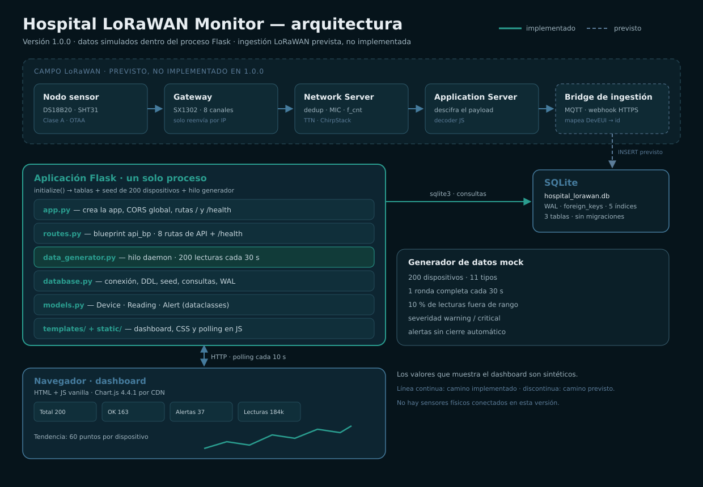
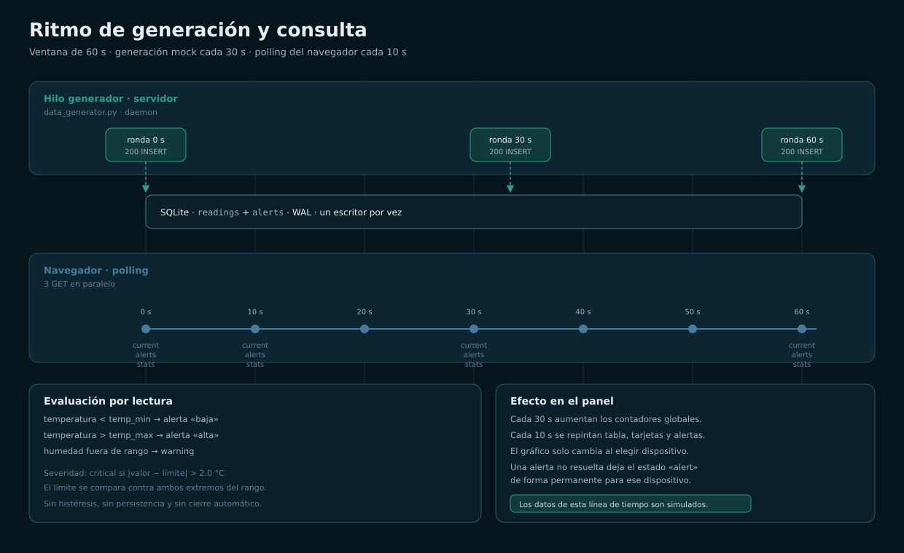
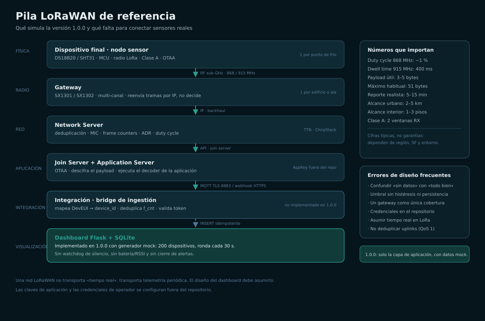

# Hospital LoRaWAN Monitor

**Dashboard de monitoreo de temperatura y humedad para cadena de frío hospitalaria, con diseño de ingestión LoRaWAN y simulación de 200 sensores.**


> **Estado de los datos — leer primero.** La versión 1.0.0 de este repositorio
> **no se conecta a ningún sensor físico**. Todas las lecturas y alertas
> provienen de un **generador sintético** (`data_generator.py`) que corre dentro
> del proceso Flask. El camino LoRaWAN real (gateway → servidor de red →
> MQTT/HTTP → base de datos) está **documentado como diseño, no implementado**.
> Ningún número del dashboard sirve para decisiones clínicas, regulatorias ni
> de mantenimiento.

---

## Tabla de contenidos

1. [Qué es este proyecto](#qué-es-este-proyecto)
2. [Datos mock vs. datos reales](#datos-mock-vs-datos-reales)
3. [El problema: cadena de frío](#el-problema-cadena-de-frío)
4. [Principio físico y de red](#principio-físico-y-de-red)
5. [Arquitectura](#arquitectura)
6. [Stack y requisitos](#stack-y-requisitos)
7. [Instalación](#instalación)
8. [Ejecución](#ejecución)
9. [Uso del dashboard](#uso-del-dashboard)
10. [Modelo de datos](#modelo-de-datos)
11. [API REST](#api-rest)
12. [Flujo de datos simulado](#flujo-de-datos-simulado)
13. [Flujo LoRaWAN real (diseño)](#flujo-lorawan-real-diseño)
14. [Simulación y escenarios](#simulación-y-escenarios)
15. [Despliegue](#despliegue)
16. [Seguridad](#seguridad)
17. [Límites conocidos](#límites-conocidos)
18. [Rendimiento y capacidad](#rendimiento-y-capacidad)
19. [Mantenimiento y respaldo](#mantenimiento-y-respaldo)
20. [Estructura del repositorio](#estructura-del-repositorio)
21. [Pruebas y verificación](#pruebas-y-verificación)
22. [Roadmap](#roadmap)
23. [Preguntas frecuentes](#preguntas-frecuentes)
24. [Licencia y atribuciones](#licencia-y-atribuciones)

---

## Qué es este proyecto

**Hospital LoRaWAN Monitor** es una aplicación web monolítica que muestra en una
pantalla el estado térmico y de humedad de hasta **200 puntos de monitoreo** de
un hospital: vitrinas de farmacia, frigobares de enfermería, refrigeradores de
cocina, freezers de −20 °C y −80 °C, cámaras mortuorias, áreas de confort
ambiental y termostatos con sonda de salas técnicas.

Está pensado como **demostrador y banco de pruebas** de una arquitectura de
monitoreo IoT para cadena de frío:

- **Backend Flask** que sirve una página HTML y una API REST JSON.
- **SQLite** como almacén embebido, sin servidor de base de datos.
- **Generador mock** en un hilo *daemon* que produce 200 lecturas cada 30 s y
  evalúa límites para crear alertas.
- **Frontend sin build**: HTML + CSS + JavaScript vanilla, Chart.js y Font
  Awesome por CDN.
- **Diseño de integración LoRaWAN** para TTN y ChirpStack, con esquema de
  payload, mapeo `DevEUI → device_id`, idempotencia y *duty cycle*.

Lo que **no** es: no controla compresores, no es producto sanitario certificado,
no reemplaza registradores validados y no implementa autenticación, autorización
ni auditoría firmada.

| Capacidad | Detalle |
|---|---|
| Inventario | 200 sensores en 11 tipos con límites propios |
| Lecturas | Temperatura siempre; humedad solo en `ambiental` |
| Alertas | Evaluación por límites, severidad `warning` / `critical` |
| Visualización | 5 tarjetas, gráfico de 60 puntos, tabla de 200 filas, panel de 20 alertas, histórico de 100 lecturas |
| Filtros | Tipo, texto (nombre/ubicación) y estado (todos/OK/alerta) |
| Actualización | Polling cada 10 s; generación cada 30 s |
| API | 10 rutas JSON con envoltura `{success, data, count}` |
| Persistencia | `hospital_lorawan.db` con WAL |
| Operación | Un proceso, sin dependencias nativas, arranque en un comando |

---

## Datos mock vs. datos reales

| Aspecto | Modo simulación (lo que corre) | Modo producción (diseño) |
|---|---|---|
| Origen | `random.gauss()` en `data_generator.py` | Sensor físico → gateway → servidor de red |
| Frecuencia | Ronda de 200 filas cada 30 s | 5–15 min por nodo según *duty cycle* |
| Identidad | `devices.id` autoincremental | `DevEUI` + `device_id` interno |
| Transporte | Ninguno: INSERT directo en SQLite | LoRaWAN RF + MQTT o webhook HTTPS |
| Humedad | Solo 30 dispositivos `ambiental` | Según sensor (SHT30/31, DHT22) |
| Fuera de rango | 10 % de probabilidad por lectura | Falla real o apertura de puerta |
| Alertas | Se crean y **nunca se resuelven solas** | Acuse y cierre por operador |
| Volumen | ~576 000 lecturas/día | ~19 200/día con 200 nodos cada 15 min |

**Regla práctica:** si el dashboard se inicia con `python app.py`, los datos son
mock. Si se conecta un *bridge* MQTT hay que **detener el generador**; de lo
contrario las lecturas sintéticas contaminan el histórico y las métricas de
disponibilidad.

El generador se reconoce en los logs:

```
[INFO] Generador de datos iniciado. Intervalo: 30s
[INFO] Generadas 200 lecturas para 200 dispositivos.
```

Para desactivarlo hay que dejar de llamar a `start_generator()` en
`initialize()` (ver [`docs/developer.md`](docs/developer.md)). Este repositorio
**no** aplica ese cambio: conserva la versión 1.0.0 tal como fue publicada.

---

## El problema: cadena de frío

| Área | Rango típico | Qué se conserva | Consecuencia de una excursión |
|---|---|---|---|
| Farmacia / vitrinas | 2 – 8 °C | Vacunas, insulinas, biológicos | Pérdida de potencia, dosis descartadas |
| Banco de sangre | 2 – 8 °C | Hemoderivados | Producto no apto para transfusión |
| Laboratorio | 2 – 8 °C | Reactivos, calibradores | Resultados inválidos |
| Cocina | 2 – 8 °C y −20 °C | Alimentos perecederos | Riesgo bromatológico |
| Biobanco | −80 °C | Tejidos, ADN, células madre | Degradación irreversible |
| Morgue | 2 – 8 °C | Conservación de cuerpos | Problema sanitario y legal |
| Áreas de pacientes | 20 – 24 °C, 30 – 60 % HR | Confort, control de infecciones | Malestar, condensación, hongos |

Puntos críticos del problema operativo:

1. **Escala**: 200 puntos en varios pisos; la ronda manual consume horas.
2. **Latencia**: una puerta mal cerrada a las 03:00 se detecta a las 08:00.
3. **Evidencia**: la normativa exige registro continuo, no una planilla por turno.
4. **Falsas alarmas**: umbrales estrechos entrenan al personal a ignorar alarmas.
5. **Costo**: perder un lote de vacunas o un biobanco cuesta órdenes de
   magnitud más que desplegar los sensores.

La arquitectura que modela el proyecto: **un nodo autónomo por punto de
conservación**, radio de bajo consumo hacia un gateway, servidor de red que
desacopla radio y aplicación, y un dashboard con alertas priorizadas. La versión
1.0.0 implementa solo la capa de aplicación y simula la de sensado.

---

## Principio físico y de red

### Medición

- **PT100/PT1000 y termopares**: usados en sondas de equipos médicos y
  freezers; alta precisión, requieren acondicionamiento analógico.
- **DS18B20**: digital 1-Wire, −55 a +125 °C, ±0.5 °C típico; común en sondas
  de penetración.
- **SHT30/SHT31**: I²C, ±0.3 °C y ±2 % HR; ideal para monitoreo ambiental.
- **DHT22**: bajo costo, ±0.5 °C, más lento y menos estable.

La incertidumbre importa: con límite 8.0 °C y sensor de ±0.5 °C, una lectura de
8.3 °C puede ser un equipo a 7.9 °C. Un sistema serio define **umbral +
histéresis + tiempo de persistencia** ("alerta si supera 8.0 °C en 3 lecturas
consecutivas"). La versión 1.0.0 evalúa **una lectura individual**, sin
histéresis ni persistencia.

### Radio LoRa

LoRa es la capa física: espectro ensanchado con *chirps* en bandas ISM sub-GHz
(868 MHz Europa, 915 MHz América, 433 MHz Asia). El factor de ensanchamiento
(SF7–SF12) intercambia velocidad por sensibilidad: SF12 llega más lejos y
penetra mejor, pero permite pocos bytes por segundo y ocupa más tiempo de aire.
Consecuencia: **el enlace no es apto para streaming**. Un nodo envía un puñado
de bytes cada varios minutos; el dashboard recibe telemetría periódica, no
"tiempo real" web.

### LoRaWAN

- **End device**: sensor + MCU + radio. Clase A por defecto (dos ventanas de
  recepción tras cada uplink); clases B y C agregan escucha a costa de batería.
- **Gateway**: concentrador multi-canal (SX1301/SX1302) que solo reenvía tramas
  por IP; no decide nada.
- **Network Server**: deduplica uplinks de varios gateways, valida MIC, gestiona
  *frame counters*, ADR y *join*.
- **Join/Application Server**: OTAA (recomendado) o ABP; descifra el payload y
  lo entrega por MQTT, HTTP o gRPC.
- **Duty cycle**: en 868 MHz la sub-banda por defecto limita a ~1 % de tiempo de
  aire; en 915 MHz hay *dwell time* de 400 ms. Eso fija la frecuencia realista.
- **Payload**: 51 bytes de aplicación como máximo habitual; con codificación
  binaria (temperatura en centésimas, humedad en un byte) un reporte cabe en
  3–5 bytes.

Cadena completa:

```
[Sensor] → [MCU] → [Radio LoRa] ⇢⇢ RF ⇢⇢ [Gateway] → IP → [Network Server]
        → [Application Server] → MQTT/HTTPS → [Bridge] → [SQLite] → [Dashboard]
```

Cada flecha es un dominio de fallo distinto. Un dashboard que solo mira la
última fila **no distingue** "el equipo está bien" de "el nodo dejó de
transmitir". Producción necesita un **watchdog de silencio** (alerta si un
dispositivo lleva N minutos sin lecturas) y batería/RSSI. Nada de eso existe en
1.0.0: el generador garantiza datos frescos para los 200 dispositivos.

---

## Arquitectura



| Componente | Archivo | Responsabilidad |
|---|---|---|
| Punto de entrada | `app.py` | Crea Flask, habilita CORS, carga `config.py`, inicializa BD, arranca generador, registra blueprint, sirve `/` y `/health` |
| Configuración | `config.py` | Rangos por tipo, cantidades, intervalos, probabilidad de falla, host/puerto |
| Dominio | `models.py` | Dataclasses `Device`, `Reading`, `Alert` con `to_dict()` |
| Persistencia | `database.py` | Conexión SQLite (WAL + FK), DDL, índices, seed, helpers |
| Simulación | `data_generator.py` | Hilo daemon, generación gaussiana, valores fuera de rango, inserción y alertas |
| API | `routes.py` | Blueprint `api_bp` con rutas JSON |
| Vista | `templates/dashboard.html` | Estructura del panel (Jinja2 sin variables) |
| Cliente | `static/js/dashboard.js` | Polling, renderizado, filtros, Chart.js |
| Estilo | `static/css/dashboard.css` | Tema claro, tarjetas, tablas, animaciones, responsive |

Flujo de una lectura mock:

1. `initialize()` crea tablas y siembra 200 dispositivos.
2. `start_generator()` lanza un `threading.Thread(daemon=True)`.
3. El hilo ejecuta `generate_all_readings()` de inmediato y luego cada 30 s.
4. Por dispositivo genera temperatura (y humedad si aplica).
5. Inserta en `readings`; si viola un límite, inserta en `alerts`.
6. El navegador consulta `/api/readings/current`, `/api/alerts` y `/api/stats`
   cada 10 s y repinta.
7. Al seleccionar un dispositivo, `/api/readings/latest/<id>` alimenta Chart.js
   con 60 puntos.

Decisiones visibles:

- **Sin ORM**: SQL directo con `sqlite3` y `Row`; menos dependencias, sin
  migraciones automáticas.
- **Sin build de frontend**: CDN para Chart.js y Font Awesome; cero Node.
- **Generación en el mismo proceso**: simple para demo, problemático con
  múltiples workers.
- **Una conexión por operación**: correcto a baja concurrencia, costoso al
  escalar.
- **Timestamps UTC**: `CURRENT_TIMESTAMP` de SQLite es UTC sin sufijo; el
  frontend agrega `Z`. La API **no** declara zona horaria.

---

## Stack y requisitos

| Capa | Tecnología | Versión | Notas |
|---|---|---|---|
| Lenguaje | Python | 3.10+ | *Type hints* modernos |
| Web | Flask | `>=3.0.0` | Sin extensions salvo CORS |
| CORS | Flask-CORS | `>=4.0.0` | `CORS(app)` global, sin allowlist |
| Base de datos | SQLite | 3.x (stdlib) | WAL, FK, índices |
| Plantillas | Jinja2 | con Flask | Plantilla estática |
| Gráficos | Chart.js | 4.4.1 (CDN) | Línea con doble eje Y |
| Iconos | Font Awesome | 6.5.1 (CDN) | Requiere Internet en el cliente |
| WSGI | Flask dev server | — | Producción: Gunicorn + Nginx |

Dependencias de Python (definidas en **`requirements.txt`**):

```
flask>=3.0.0
flask-cors>=4.0.0
```

Sin dependencias nativas, sin Node, sin base externa: todo cabe en un
directorio y un archivo `.db`.

### Servidor

| Recurso | Mínimo (demo) | Recomendado (piloto) |
|---|---|---|
| CPU | 2 núcleos | 4 núcleos |
| RAM | 1 GB | 4 GB |
| Disco | 500 MB + crecimiento de BD | 20 GB SSD |
| SO | Linux, macOS, WSL2 | Debian 12 / Ubuntu 22.04 / Raspberry Pi OS |
| Python | 3.10 | 3.12 |
| Red | Salida a Internet solo para CDN | Reverse proxy con TLS |

### Cliente

Navegador con JavaScript (Chrome 90+, Firefox 88+, Edge 90+, Safari 14+),
resolución mínima 1280×720 y **acceso a Internet** para los CDN. En una red
hospitalaria segmentada hay que alojar Chart.js y Font Awesome localmente.

---

## Instalación

Las dependencias están declaradas en **`requirements.txt`**. Los comandos se
ejecutan dentro de la carpeta de la versión:

```bash
cd versions/hospital-lorawan-dashboard
```

### 1. Entorno virtual

```bash
python3 -m venv venv
source venv/bin/activate        # Linux / macOS
venv\Scripts\activate           # Windows (cmd)
venv\Scripts\Activate.ps1       # Windows (PowerShell)
```

### 2. Dependencias

```bash
python -m pip install --upgrade pip
pip install -r requirements.txt
```

### 3. Verificación

```bash
python -c "import flask, flask_cors; print(flask.__version__)"
```

Debe imprimir `3.x`. Si falla, el entorno no está activo o `pip` apunta a otro
intérprete.

> **Rutas**: `config.py` calcula `DB_PATH` como
> `os.path.join(os.path.dirname(os.path.abspath(__file__)), "hospital_lorawan.db")`.
> La base se crea **junto a los `.py`**, no en el directorio desde donde se
> lanza el comando. En un directorio de solo lectura el arranque falla con
> `sqlite3.OperationalError: unable to open database file`.

### 4. Estructura mínima resultante

```
hospital-lorawan-dashboard/
├── venv/                     # no versionado
├── app.py
├── config.py
├── database.py
├── data_generator.py
├── models.py
├── routes.py
├── requirements.txt
├── hospital_lorawan.db       # se crea al primer arranque
├── templates/dashboard.html
└── static/{css,js}/...
```

---

## Ejecución

### Modo desarrollo

```bash
python app.py
```

Salida esperada (resumida):

```
[INFO] Iniciando Dashboard de Monitoreo Hospitalario LoRaWAN
[INFO] Paso 1/2: Inicializando base de datos...
[INFO] Tablas de base de datos creadas/verificadas correctamente.
[INFO] Seed completado: 200 dispositivos insertados.
[INFO] Paso 2/2: Arrancando generador de datos LoRaWAN...
[INFO] Thread generador de datos iniciado.
[INFO] Sistema listo. Navega a http://localhost:5000
 * Serving Flask app 'app'
 * Debug mode: on
```

Abrir <http://localhost:5000>.

> **Ojo con el *reloader***: `FLASK_DEBUG = True` activa el *reloader* de
> Werkzeug, que ejecuta el proceso dos veces. El hilo generador arranca en
> ambos, así que se ven rondas duplicadas en los primeros segundos y logs
> repetidos. Para demos estables, `FLASK_DEBUG = False`.

### Verificación rápida

```bash
curl -s http://localhost:5000/health
# {"service":"Hospital LoRaWAN Dashboard","status":"ok","version":"1.0.0"}

curl -s http://localhost:5000/api/stats | head -c 400
```

Para detener: `Ctrl+C`. El hilo es *daemon* y muere con el proceso;
`stop_generator()` existe pero no está expuesta por ninguna ruta ni manejador
de señales.

---

## Uso del dashboard



### Barra superior

Nombre del sistema, indicador **EN VIVO** pulsante, hora de la última
actualización exitosa y botón de refresco manual.

### Tarjetas de resumen

| Tarjeta | Origen | Comentario |
|---|---|---|
| Total Dispositivos | `COUNT(*) FROM devices WHERE active=1` | 200 por defecto |
| Dispositivos OK | Conteo en cliente de `status === "ok"` | Depende de alertas **no resueltas** |
| Alertas Activas | `COUNT(*) FROM alerts WHERE resolved=0` | Cuenta alertas, no dispositivos |
| Total Lecturas | `COUNT(*) FROM readings` | Crece ~576 000/día |
| Lecturas 24h | `timestamp >= datetime('now','-24 hours')` | UTC |

### Filtros

- **Tipo**: lista fija de 11 tipos.
- **Buscar**: texto libre contra nombre y ubicación.
- **Estado**: Todos / OK / Alerta, combinable con los anteriores.

Son **de cliente**: no vuelven a consultar la API; la tabla mantiene las 200
filas en memoria y solo oculta las que no coinciden.

### Gráfico de tendencia

- Selección por desplegable o clic en el nombre de un dispositivo.
- Temperatura (°C) en el eje izquierdo y humedad (%HR) en el derecho, oculta si
  el dispositivo no reporta humedad.
- Últimos 60 puntos (≈30 min con generación cada 30 s).
- **No se refresca solo**: se redibuja al cambiar de dispositivo o refrescar.

### Tabla de dispositivos

Columnas `#`, Nombre, Tipo, Ubicación, Temperatura, Humedad, Estado, Última
lectura. El color de la temperatura depende de la desviación respecto del punto
medio (verde dentro de rango, ámbar hasta 3 °C, rojo más). Las filas en alerta
llevan fondo rojizo y badge parpadeante.

### Panel de alertas y últimas lecturas

Panel con las 20 alertas no resueltas más recientes (mensaje y severidad) y
tabla con las 100 lecturas más recientes, con refresco independiente.

---

## Modelo de datos

SQLite, tres tablas y cinco índices. DDL efectivo de
`database.create_tables()`:

```sql
CREATE TABLE devices (
    id            INTEGER PRIMARY KEY AUTOINCREMENT,
    device_type   TEXT NOT NULL,
    name          TEXT NOT NULL,
    location      TEXT,
    temp_min      REAL NOT NULL,
    temp_max      REAL NOT NULL,
    humidity_min  REAL,
    humidity_max  REAL,
    active        INTEGER DEFAULT 1
);

CREATE TABLE readings (
    id          INTEGER PRIMARY KEY AUTOINCREMENT,
    device_id   INTEGER NOT NULL,
    temperature REAL NOT NULL,
    humidity    REAL,
    timestamp   DATETIME DEFAULT CURRENT_TIMESTAMP,
    FOREIGN KEY (device_id) REFERENCES devices(id)
);

CREATE TABLE alerts (
    id         INTEGER PRIMARY KEY AUTOINCREMENT,
    device_id  INTEGER NOT NULL,
    reading_id INTEGER,
    parameter  TEXT NOT NULL,
    value      REAL NOT NULL,
    min_limit  REAL,
    max_limit  REAL,
    message    TEXT NOT NULL,
    severity   TEXT DEFAULT 'warning',
    resolved   INTEGER DEFAULT 0,
    created_at DATETIME DEFAULT CURRENT_TIMESTAMP,
    FOREIGN KEY (device_id) REFERENCES devices(id)
);

CREATE INDEX idx_readings_device_id ON readings(device_id);
CREATE INDEX idx_readings_timestamp ON readings(timestamp);
CREATE INDEX idx_alerts_device_id   ON alerts(device_id);
CREATE INDEX idx_alerts_resolved    ON alerts(resolved);
CREATE INDEX idx_alerts_created_at  ON alerts(created_at);
```

Relaciones:

```
devices 1 ──── N readings
devices 1 ──── N alerts
readings 1 ─── 0..1 alerts   (reading_id, enlace lógico sin FK declarada)
```

`PRAGMA foreign_keys=ON` se activa en cada conexión, así que `device_id` sí se
valida; `alerts.reading_id` no tiene restricción.

| Campo | Semántica |
|---|---|
| `device_type` | Clave del diccionario `DEVICE_TYPES` |
| `temp_min/max` | Límites **copiados** al sembrar; cambiarlos en `config.py` no altera filas existentes |
| `humidity_min/max` | Solo poblados en `ambiental` |
| `active` | 0 excluye de listados y de la generación |
| `readings.timestamp` | UTC, `YYYY-MM-DD HH:MM:SS`, sin sufijo de zona |
| `alerts.parameter` | `temperature` o `humidity` |
| `alerts.severity` | `warning` o `critical` |
| `alerts.resolved` | 0 = activa; **ningún código lo pone en 1** |

Invariantes que el código **no** garantiza: sin `CHECK` sobre `severity`,
`parameter` ni `resolved`; sin unicidad de nombre; sin borrado en cascada; sin
tabla de migraciones ni `PRAGMA user_version`.

### Volumen

200 filas por ronda, 6 666 por hora, **~576 000 por día**, ~4 millones por
semana. Medición real:

```bash
sqlite3 hospital_lorawan.db \
  "SELECT COUNT(*) AS lecturas, datetime(MIN(timestamp)) AS desde,
          datetime(MAX(timestamp)) AS hasta FROM readings;"
```

---

## API REST

Envoltura de éxito: `{"success": true, "data": ..., "count": N}`. Errores:
`{"success": false, "error": "..."}` con 404, 415 o 500. Sin versión en la ruta
ni paginación por cursor.

| Método | Ruta | Descripción |
|---|---|---|
| GET | `/` | Dashboard HTML |
| GET | `/health` | Estado del servicio |
| GET | `/api/devices` | Dispositivos activos; `device_type`, `search` |
| GET | `/api/devices/<id>` | Dispositivo + `last_reading`; 404 si no existe |
| GET | `/api/readings` | Lecturas recientes; `limit` (100), `device_id` |
| GET | `/api/readings/current` | Última lectura por dispositivo + `status` |
| GET | `/api/readings/latest/<id>` | 60 lecturas ascendentes |
| GET | `/api/alerts` | Alertas no resueltas; `limit` (20), `device_id` |
| GET | `/api/stats` | Agregados y distribución por tipo |
| POST | `/api/generate` | Fuerza una ronda mock |

```bash
curl -s "http://localhost:5000/api/devices?device_type=freezer_80" | python -m json.tool
curl -s "http://localhost:5000/api/devices?search=Laboratorio"
curl -s http://localhost:5000/api/readings/current | python -m json.tool | head -40
curl -s http://localhost:5000/api/readings/latest/141
curl -s -X POST http://localhost:5000/api/generate \
     -H "Content-Type: application/json" -d '{}'
# {"count":200,"message":"Generadas 200 lecturas correctamente.","success":true}

curl -s -X POST http://localhost:5000/api/generate
# HTTP 415 {"success":false,"error":"Content-Type no soportado. ..."}
```

Forma de `/api/readings/current` (una fila por dispositivo):

```json
{
  "device_id": 1,
  "device_type": "vitrina_refrigerada",
  "name": "Vitrina Refrigerada #001",
  "location": "Pasillo A",
  "temp_min": 2.0, "temp_max": 8.0,
  "humidity_min": null, "humidity_max": null,
  "reading_id": 15234,
  "temperature": 5.2, "humidity": null,
  "timestamp": "2026-06-10 14:30:00",
  "alert_id": null, "alert_severity": null,
  "status": "ok"
}
```

`status` se calcula en el servidor: `alert` si existe **cualquier** alerta no
resuelta para el dispositivo **o** si la lectura actual viola un límite.

Forma de `/api/stats`:

```json
{
  "success": true,
  "data": {
    "total_devices": 200,
    "devices_with_alerts": 37,
    "total_readings": 184320,
    "total_alerts": 4211,
    "last_update": "2026-06-10 14:30:00",
    "readings_24h": 184320,
    "type_distribution": [{"device_type": "ambiental", "count": 30}],
    "recent_alerts": []
  }
}
```

| Caso | Código | Cuerpo |
|---|---|---|
| Dispositivo inexistente | 404 | `{"success": false, "error": "Dispositivo no encontrado"}` |
| `POST /api/generate` sin JSON/form | 415 | mensaje sobre `Content-Type` |
| Excepción al generar | 500 | `{"success": false, "error": "Error al generar lecturas: ..."}` |

No se valida `limit` (`?limit=99999999` intenta devolver todo). No hay *rate
limiting* ni autenticación.

---

## Flujo de datos simulado

### Algoritmo de temperatura

```
center = (temp_min + temp_max) / 2
si random() < 0.10:                      # 10 % de las lecturas
    offset = uniform(0.05, 0.30) * max(|temp_max - temp_min|, 1.0)
    valor = temp_max + offset   (50 %)
          = temp_min - offset   (50 %)
si no:
    si tipo estable (freezers y congelador combinado):
        valor = gauss(center, 0.3) acotado a [temp_min - 0.5, temp_max + 0.5]
    si no:
        valor = gauss(center, 0.15 * (temp_max - temp_min)) acotado al rango
redondear a 2 decimales
```

### Humedad

Solo para dispositivos con `humidity_min`/`humidity_max` (los 30 `ambiental`).
Misma lógica: 10 % fuera de rango (acotado a 0–100), 90 % gaussiana con
`std_dev = 0.10 * rango`.

### Severidad

```python
severity = "critical" if abs(temp - temp_min) > 2.0 or abs(temp - temp_max) > 2.0 else "warning"
```

La humedad siempre es `warning`. La comparación usa **ambos** límites: con
rangos mayores a 2 °C, una excursión por encima del máximo suele resultar
`critical` porque `temp - temp_min` supera 2.

### Efectos secundarios matemáticos

- En freezers (−20.5 a −19.5) el acotado permite `[−21.0, −19.0]`, es decir
  valores fuera de rango **además** del 10 % nominal. La tasa efectiva de
  alerta en esos tipos es mayor que la configurada.
- No hay **inercia térmica** entre rondas: cada lectura es independiente. Un
  freezer puede saltar de −20.1 a −19.4 y volver; en la realidad la masa
  térmica suaviza la serie.
- El 10 % se sortea por lectura y por magnitud, así que un ambiental puede
  generar dos alertas en la misma ronda.

### Ritmo temporal

| Evento | Cada | Efecto |
|---|---|---|
| Generación | 30 s | 200 INSERT en `readings`, 0–40 en `alerts` |
| Polling UI | 10 s | 3 GET (`current`, `alerts`, `stats`) |
| Gráfico | Al seleccionar | 1 GET de 60 filas |
| Histórico | Manual | 1 GET de 100 filas |

Con un navegador abierto: ~18 peticiones por minuto, cada una con una consulta
que recorre 200 dispositivos. Carga trivial para SQLite, pero relevante con
muchas pestañas.

---

## Flujo LoRaWAN real (diseño)

Esta sección describe **cómo se integraría** una red real. No hay código de
ingestión en 1.0.0; los bloques son plantillas.



```
Nodos (Clase A) ⇢ Gateway(s) → Network Server → Application Server
                                                     │
                                     MQTT (TLS) o webhook HTTPS
                                                     ▼
                                       bridge de ingestión
                                                     │
                                   mapeo DevEUI → devices.id
                                                     ▼
                                            SQLite + dashboard
```

### Registro de dispositivos

En TTN o ChirpStack se crea una *application* y se registran los nodos con
OTAA. Se obtiene `DevEUI`, `JoinEUI`, `AppKey` (secreto, **nunca** en el
repositorio) y un *payload decoder*. El dashboard necesita una columna que hoy
no existe: `dev_eui TEXT UNIQUE` en `devices`. Para un piloto alcanza con un
diccionario en el bridge (`{"70B3D57ED0000001": 141, ...}`).

### Formato de payload (ejemplo, 5 bytes big-endian)

| Bytes | Campo | Escala | Unidad |
|---|---|---|---|
| 0–1 | `temperature` | int16 / 100 | °C |
| 2 | `humidity` | uint8 | % HR |
| 3 | `battery` | uint8 / 10 | V |
| 4 | `flags` | bitfield | puerta, falla |

Decoder para TTN (se pega en la consola de la aplicación):

```js
function decodeUplink(input) {
  const b = input.bytes;
  const rawT = (b[0] << 8) | b[1];
  const temp = ((rawT & 0x8000 ? rawT - 0x10000 : rawT) / 100);
  return {
    data: {
      temperature: temp,
      humidity: b[2],
      battery_v: b[3] / 10,
      door_open: !!(b[4] & 0x01),
      fault: !!(b[4] & 0x02)
    },
    warnings: [], errors: []
  };
}
```

### Ingestión por MQTT (TTN v3)

```python
# bridge_ttn.py — esqueleto, NO incluido en la versión 1.0.0
import json, os
import paho.mqtt.client as mqtt

APP_ID  = os.environ["TTN_APP_ID"]
API_KEY = os.environ["TTN_API_KEY"]          # nunca hardcodear
BROKER  = "eu1.cloud.thethings.network"      # verificar host por región
TOPIC   = f"v3/{APP_ID}/devices/+/up"
EUI_MAP = {"70B3D57ED0000001": 141}          # DevEUI → devices.id

def on_connect(client, userdata, flags, reason_code, properties=None):
    client.subscribe(TOPIC, qos=1)

def on_message(client, userdata, msg):
    payload = json.loads(msg.payload)
    eui = payload["end_device_ids"]["dev_eui"]
    decoded = payload["uplink_message"].get("decoded_payload") or {}
    device_id = EUI_MAP.get(eui)
    if device_id is None or "temperature" not in decoded:
        return
    # INSERT en readings + evaluación de límites (misma lógica que el mock)
```

Notas de integración:

- **TLS obligatorio** (8883 con CA del servidor); nunca 1883 en abierto.
- **Credenciales por entorno**, nunca en el código.
- **QoS 1** implica duplicados: el bridge debe ser idempotente (tabla
  `processed(f_cnt, dev_eui)` o restricción única por `(device_id, f_cnt)`).
- **`f_cnt`**: descartar uplinks con contador menor o igual al último visto.
- **Fragmentación**: payloads parciales requieren reensamblado; con 5 bytes no
  aplica.

### Ingestión por webhook (ChirpStack / TTN)

Alternativa sin broker: el servidor de red hace `POST /ingest` con el evento
`up`. Requiere token compartido en cabecera, límite de tamaño, *rate limit*,
respuesta 2xx rápida y registro de `deduplication_id` para descartar reenvíos.
El dashboard no tiene esa ruta; agregarla implica un blueprint y configuración
(`INGEST_TOKEN`, `INGEST_ENABLED`).

### Desactivar el mock

En `app.py`, `initialize()` llama siempre a `start_generator()`. Para producción:

```python
def initialize() -> None:
    from database import initialize_database
    initialize_database()
    if os.environ.get("MOCK_DATA", "0") == "1":
        from data_generator import start_generator
        start_generator()
```

Es un cambio de tres líneas, **no aplicado** para preservar el comportamiento
reproducible de la versión publicada.

### Diferencias operativas

| Tema | Mock | Real |
|---|---|---|
| Latencia | ≤30 s garantizado | 5–15 min típico |
| Silencio | Imposible | Frecuente (batería, cobertura) |
| Duplicados | No | Sí (QoS 1, varios gateways) |
| Reloj | Del servidor | Del servidor de red |
| Calidad | Sintética perfecta | Ruido, deriva, autocalentamiento |
| Volumen | Constante | Variable, con ráfagas tras reconexión |

---

## Simulación y escenarios

### Forzar una ronda

```bash
curl -X POST http://localhost:5000/api/generate \
     -H "Content-Type: application/json" -d '{}'
```

Devuelve el número de lecturas insertadas (200 si todos están activos).

### Cambiar la densidad de fallas

```python
OUT_OF_RANGE_PROBABILITY = 0.10   # 0.0 = nunca; 1.0 = todo fuera de rango
```

Con `0.0` el panel queda vacío y todas las tarjetas muestran "todo OK" (siempre
que no haya alertas históricas). Con `1.0` se saturan alertas y se evalúa el
comportamiento visual.

### Escenario: cadena de frío sana

`OUT_OF_RANGE_PROBABILITY = 0.0`, borrar `hospital_lorawan.db`, reiniciar.
Tarjetas en verde y cero alertas.

### Escenario: freezers en riesgo

`OUT_OF_RANGE_PROBABILITY = 0.3`, filtrar `freezer_80` (4 dispositivos) y
observar cómo la serie salta alrededor de −80 °C sin suavizado: evidencia la
ausencia de inercia térmica en el mock.

### Escenario: dispositivo puntual

No hay endpoint para inyectar una lectura arbitraria; la vía es SQL directo:

```bash
sqlite3 hospital_lorawan.db <<'SQL'
INSERT INTO readings (device_id, temperature, humidity)
VALUES (141, -75.0, NULL);
INSERT INTO alerts (device_id, reading_id, parameter, value, min_limit,
                    max_limit, message, severity)
VALUES (141, last_insert_rowid(), 'temperature', -75.0, -80.5, -79.5,
        'Temperatura alta: -75.0°C (máximo: -79.5°C)', 'critical');
SQL
```

Al refrescar, el dispositivo aparece en alerta y el gráfico muestra el pico.

---

## Despliegue

### Gunicorn + Nginx (recomendado para piloto)

**Un solo worker**: el generador no está sincronizado entre procesos; con
`--workers 2` habría dos generadores duplicando filas.

```bash
pip install gunicorn
gunicorn --workers 1 --threads 4 --bind 127.0.0.1:8000 app:app
```

`app:app` importa la app **sin** ejecutar `initialize()`, que solo corre bajo
`__main__`. Con Gunicorn hay que inicializar la base aparte: (1) ejecutar una
vez `python app.py` para crear y sembrar la BD, aceptando que no habrá
generación, o (2) añadir un `wsgi.py` que llame a `initialize()` antes de
exponer `app`.

Unidad systemd mínima:

```ini
[Unit]
Description=Hospital LoRaWAN Dashboard
After=network.target

[Service]
Type=simple
User=monitor
WorkingDirectory=/opt/hospital-lorawan
Environment=PYTHONUNBUFFERED=1
ExecStart=/opt/hospital-lorawan/venv/bin/gunicorn \
          --workers 1 --threads 4 --bind 127.0.0.1:8000 app:app
Restart=always
RestartSec=5
NoNewPrivileges=true
PrivateTmp=true
ProtectSystem=strict
ReadWritePaths=/opt/hospital-lorawan

[Install]
WantedBy=multi-user.target
```

Nginx como terminador TLS y servidor de estáticos:

```nginx
server {
    listen 443 ssl http2;
    server_name monitor.hospital.local;
    ssl_certificate     /etc/ssl/certs/monitor.crt;
    ssl_certificate_key /etc/ssl/private/monitor.key;

    location /static/ {
        alias /opt/hospital-lorawan/static/;
        expires 1h;
    }
    location / {
        proxy_pass http://127.0.0.1:8000;
        proxy_set_header Host $host;
        proxy_set_header X-Forwarded-For $proxy_add_x_forwarded_for;
        proxy_set_header X-Forwarded-Proto $scheme;
    }
}
```

> `FLASK_DEBUG = True` es **incompatible con producción**: expone el depurador
> interactivo de Werkzeug, que permite ejecución remota de código si el puerto
> es accesible.

### Raspberry Pi como piloto

Funciona en Pi 3/4/5 con Raspberry Pi OS de 64 bits. Usar SSD o microSD de
grado industrial (WAL es sensible a cortes), programar respaldos y
`PRAGMA wal_checkpoint(TRUNCATE)` periódico, y alojar los CDN localmente si la
red está aislada.

### Checklist de puesta en marcha

- [ ] `FLASK_DEBUG = False`.
- [ ] CORS restringido a orígenes reales.
- [ ] TLS terminado en el proxy.
- [ ] Autenticación delante del dashboard (basic auth o SSO).
- [ ] Espacio en disco suficiente y monitoreado.
- [ ] Respaldo automático de la BD.
- [ ] Generador mock detenido si hay fuente real.
- [ ] Zona horaria alineada (todo en UTC).
- [ ] Rotación de logs.

---

## Seguridad

La versión 1.0.0 es un **demostrador**, no un sistema endurecido.

| Riesgo | Dónde | Mitigación |
|---|---|---|
| Sin autenticación | Toda la app | Proxy con basic auth, OIDC o VPN |
| Sin autorización | API completa | Roles: lectura vs. acuse de alertas |
| CORS abierto | `CORS(app)` global | `CORS(app, resources={r"/api/*": {"origins": [...]}})` |
| Debug activo | `FLASK_DEBUG = True` | `False` en cualquier entorno compartido |
| Escucha en `0.0.0.0` | `FLASK_HOST` | `127.0.0.1` detrás de proxy |
| Sin TLS | Flask directo | Terminar TLS en Nginx/Traefik |
| Sin rate limit | `/api/*` | Límite en el proxy (p. ej. 60 r/m por IP) |
| `POST /api/generate` abierto | Ruta de escritura | Deshabilitar o proteger con token |
| Sin auditoría | Base de datos | Registrar accesos y cambios de estado |
| `limit` sin validar | `/api/readings` | Acotar a un máximo (p. ej. 1000) |
| Errores con detalle interno | `routes.py` devuelve `str(e)` | Loguear y devolver mensaje genérico |

### Secretos

El repositorio **no contiene credenciales**. La base, los archivos WAL y
cualquier `.env` están excluidos por `.gitignore`. Para una integración real:
`TTN_API_KEY`, `MQTT_PASSWORD` e `INGEST_TOKEN` por variables de entorno, nunca
en `config.py`, README ni capturas. Rotar claves al cambiar de operador. Los
`AppKey` de los nodos se cargan en el servidor de red, no en el dashboard.

### Datos sensibles

No se almacena información identificable de pacientes: solo temperaturas,
humedad, nombres de equipos y ubicaciones genéricas ("Pasillo A", "Quirófano
2"). Aun así, la ubicación de equipos y sus horarios de falla son información
operativa interna.

### Superficie de ataque real

- `/api/generate` permite insertar 200 filas por petición: un bucle trivial
  infla la base y distorsiona métricas. Es el endpoint más peligroso.
- El *debugger* de Werkzeug expuesto es ejecución remota de código.
- El CORS abierto permite que cualquier sitio consulte la API desde el
  navegador de un operador.

---

## Límites conocidos

Derivados de leer el código, no de la documentación previa. Son los que más
sorprenden al operar la demo.

1. **Las alertas nunca se resuelven.** `alerts.resolved` se inicializa en 0 y
   ningún código lo actualiza: no hay endpoint de acuse, job de cierre ni
   transición al volver a rango. Por eso `Dispositivos OK` tiende a 0,
   `Alertas Activas` crece de forma monótona (~20 alertas cada 30 s) y el
   `status` de un dispositivo queda en `alert` para siempre. Cierre manual:

   ```bash
   sqlite3 hospital_lorawan.db \
     "UPDATE alerts SET resolved = 1 WHERE created_at < datetime('now','-1 hour');"
   ```

   Para operación real hace falta `PATCH /api/alerts/<id>` y una regla de
   negocio (acuse por operador, cierre por normalización sostenida).

2. **`Dispositivos OK` no significa "sanos".** Mide "dispositivos sin alertas
   pendientes", no "dentro de rango ahora".

3. **Crecimiento sin retención.** 576 000 filas/día; en una semana la tabla
   supera 4 millones. `COUNT(*)` en `/api/stats` se vuelve costoso y hace falta
   `VACUUM`.

4. **Un solo proceso.** Dos instancias o dos workers duplican lecturas y
   compiten por el archivo. WAL tolera lectores concurrentes, pero un escritor
   por vez.

5. **Sin migraciones.** Cambiar `DEVICE_TYPES` no actualiza dispositivos
   existentes: el seed solo inserta si `devices` está vacía. Cambiar columnas
   exige borrar la BD o migrar a mano.

6. **Sin watchdog de silencio.** Si un dispositivo dejara de reportar, el panel
   seguiría mostrando su última lectura como actual; no hay comparación con
   `now()` ni marca de "dato viejo".

7. **Zona horaria implícita.** La API entrega `"2026-06-10 14:30:00"` sin `Z`;
   el JS asume UTC y agrega `Z`. Otros clientes que lo interpreten como hora
   local mostrarán desfases.

8. **Filtros solo de cliente.** `applyFilters()` no consulta la API; si se
   pagina el inventario, habrá que moverlos al servidor (las rutas ya aceptan
   `device_type` y `search`, pero el frontend no las usa).

9. **Gráfico no autoactualizable.** Solo se redibuja al cambiar de selección o
   refrescar; no hay `setInterval` sobre `updateChart()`.

10. **Dependencia de CDN.** Sin Internet en el cliente no hay gráfico ni iconos;
    los datos siguen funcionando.

---

## Rendimiento y capacidad

| Operación | Coste | Comentario |
|---|---|---|
| Ronda de generación | 200 INSERT + hasta ~40 de alertas | 200 conexiones/commit por ronda |
| `/api/readings/current` | 1 consulta con 2 subconsultas por fila | ~200 × 2 búsquedas por índice |
| `/api/stats` | 4 `COUNT(*)` + 2 agregados | Degrada con el histórico |
| `/api/readings/latest/<id>` | 1 consulta indexada + `LIMIT 60` | Muy rápida |
| Polling | 3 peticiones / 10 s por pestaña | ~18 r/m |

Cuellos de botella previsibles:

1. `COUNT(*)` sobre `readings` sin filtro: recorre índice completo.
2. Apertura y cierre de conexión por INSERT: aceptable a 30 s, limitante si se
   baja `GENERATION_INTERVAL`.
3. `sqlite3` síncrono en el hilo del generador: bloquea brevemente a los
   lectores; WAL lo mitiga.
4. Renderizado de 200 filas cada 10 s: se reescribe el `innerHTML` completo,
   con *flicker* y pérdida de selección de texto.

Recomendaciones de escalado:

- **1–50 dispositivos**: configuración actual.
- **50–500**: índices suficientes; agregar retención y purga.
- **500–5 000**: PostgreSQL, ingestión asíncrona, workers separados.
- **>5 000**: TimescaleDB/InfluxDB, cola de mensajes y dashboard separado de
  la ingestión.

---

## Mantenimiento y respaldo

### Respaldo consistente con WAL

Copiar el `.db` durante escrituras puede producir una copia inconsistente.
Usar la API de backup:

```bash
sqlite3 hospital_lorawan.db ".backup '/backup/hospital-$(date +%F).db'"
```

O detener el servicio y copiar los tres archivos (`db`, `db-wal`, `db-shm`).

### Retención

```sql
DELETE FROM readings WHERE timestamp < datetime('now','-30 days');
DELETE FROM alerts WHERE resolved = 1 AND created_at < datetime('now','-90 days');
VACUUM;
```

Tras un `DELETE` masivo el archivo no se reduce hasta `VACUUM`, que necesita
espacio libre igual al de la BD.

### Integridad y reset

```bash
sqlite3 hospital_lorawan.db "PRAGMA integrity_check;"
sqlite3 hospital_lorawan.db "PRAGMA foreign_key_check;"

# Reset de demostración (con la app detenida)
rm -f hospital_lorawan.db hospital_lorawan.db-wal hospital_lorawan.db-shm
python app.py
```

### Exportación

```bash
sqlite3 -header -csv hospital_lorawan.db \
 "SELECT d.name, d.device_type, d.location, r.temperature, r.humidity, r.timestamp
  FROM readings r JOIN devices d ON d.id = r.device_id
  WHERE r.timestamp >= datetime('now','-1 day')
  ORDER BY r.timestamp DESC;" > lecturas_24h.csv

curl -s "http://localhost:5000/api/readings?limit=1000" > lecturas.json
```

---

## Estructura del repositorio

```
hospital-lorawan/
├── README.md                      # este documento
├── LICENSE                        # MIT
├── docs/
│   ├── datasheet.md               # documentación de usuario
│   ├── developer.md               # documentación técnica y API interna
│   ├── REFERENCES.md              # fuentes y buenas prácticas
│   └── assets/
│       ├── architecture.svg
│       ├── data-flow.svg
│       └── lorawan-stack.svg
└── versions/
    └── hospital-lorawan-dashboard/   # código 1.0.0 (sin modificar)
        ├── app.py, config.py, database.py, data_generator.py,
        │   models.py, routes.py, requirements.txt
        ├── README.md, VERSION.md, .gitignore
        ├── templates/dashboard.html
        ├── static/css/dashboard.css
        ├── static/js/dashboard.js
        └── docs/{datasheet.md,developer.md}
```

`versions/hospital-lorawan-dashboard/` es una **copia preservada** del proyecto
original: no se edita al actualizar la documentación del portfolio. Los comandos
de instalación y ejecución se corren dentro de esa carpeta.

---

## Pruebas y verificación

No hay suite automatizada. Verificación manual mínima:

| # | Prueba | Esperado |
|---|---|---|
| 1 | `python app.py` | Logs de BD, seed y generador sin excepciones |
| 2 | `curl /health` | `status: ok`, versión 1.0.0 |
| 3 | `curl /api/devices` | `count: 200` |
| 4 | `curl /api/stats` | `total_devices: 200`, `last_update` no nulo |
| 5 | `POST /api/generate` con JSON | `count: 200` |
| 6 | `POST /api/generate` sin cabecera | HTTP 415 |
| 7 | `GET /api/devices/99999` | HTTP 404 |
| 8 | Abrir `/` | 5 tarjetas, tabla poblada, gráfico al seleccionar |
| 9 | Esperar 30 s | Total de lecturas +200 |
| 10 | Filtrar `freezer_80` | 4 filas |
| 11 | Buscar "Laboratorio" | Subconjunto coherente |
| 12 | `PRAGMA integrity_check` | `ok` |

Verificación de sintaxis sin servidor:

```bash
python -m compileall -q .
```

---

## Roadmap

1. **Ciclo de vida de alertas**: acuse, cierre automático tras N lecturas en
   rango, histéresis y agrupación por dispositivo.
2. **Ingestión real**: bridge MQTT, columna `dev_eui`, deduplicación por
   `f_cnt`.
3. **Watchdog de silencio** y batería/RSSI.
4. **Retención automática** y métricas de tamaño.
5. **Autenticación y roles** (lectura, operador, administrador).
6. **Exportación** CSV/PDF desde la UI.
7. **Notificaciones** por correo, Slack o SMS para `critical`.
8. **PostgreSQL** para >500 dispositivos.
9. **Pruebas** con `pytest` y base temporal.
10. **CDN local** para redes aisladas.

---

## Preguntas frecuentes

**¿Necesito sensores para probarlo?**
No. El generador crea 200 dispositivos y lecturas desde el primer arranque.

**¿Los datos son reales?**
No, son sintéticos. Ver [Datos mock vs. datos reales](#datos-mock-vs-datos-reales).

**¿Puedo cambiar la cantidad de dispositivos?**
Sí, editando `count` en `DEVICE_TYPES` y recreando la BD; el seed solo corre con
la tabla vacía.

**¿Funciona sin Internet?**
El backend sí; el frontend necesita Chart.js y Font Awesome desde CDN.

**¿Puedo abrirlo desde otro equipo?**
Sí: escucha en `0.0.0.0:5000`. En red hospitalaria, solo detrás de proxy y
autenticación.

**¿Se pierde el histórico al reiniciar?**
No. Persiste en `hospital_lorawan.db`.

**¿Sirve para cumplir normativa?**
No por sí solo: no hay auditoría inmutable, calibración trazable ni validación
de software. Es una base técnica, no un registro regulatorio.

---

## Ficha de evaluación

**Madurez global: 4.2/5**

| Criterio | Nota | Evidencia |
|---|---:|---|
| Madurez | 3/5 | Demostración funcional con API, base y alertas; sin pruebas ni uso clínico. |
| Reproducibilidad | 4/5 | requirements.txt, un comando y semilla fija permiten levantar el panel sin servicios externos. |
| Documentación | 5/5 | README extenso con arquitectura, límites, consultas SQL y ruta LoRaWAN documentada. |
| Honestidad de límites | 5/5 | Declara datos simulados, ausencia de autenticación, alertas sin cierre y falta de retención. |
| Valor demostrativo | 4/5 | Muestra visualización, modelo y alertas de cadena de frío con datos creíbles. |
| Facilidad de despliegue | 4/5 | Flask y SQLite sin dependencias nativas; requiere desactivar debug y servir estáticos. |

Panel demostrativo sólido en documentación y reproducible en local, condicionado por datos simulados, alertas que no se cierran y un diseño LoRaWAN que aún no se implementa.

## Lo que no funcionó

### 1.0.0 — Datos simulados en lugar de sensores

La versión reproducida no se conecta a sensores físicos: un generador gaussiano crea las lecturas y el camino LoRaWAN real queda descrito como diseño. El README indica que desactivar el mock son tres líneas, pero no se aplicó para conservar intacta la versión original de Wander Cáceres H. Se documentó el reemplazo por ingesta MQTT o HTTP.

### 1.0.0 — Alertas sin ciclo de vida

Las alertas se crean pero nunca se resuelven: el campo resolved permanece en cero porque no existe endpoint de acuse. En consecuencia, 'Dispositivos OK' tiende a cero y el número de alertas crece mientras el generador sigue produciendo lecturas. El README documenta el problema y propone un PATCH para cerrarlas, sin implementarlo.

### 1.0.0 — Evaluación sin histéresis

Cada lectura se evalúa contra el umbral de forma aislada, aunque el sensor declara una incertidumbre de ±0,5 °C. Una medición de 8,3 °C puede corresponder a 7,9 °C y disparar una alerta evitable. El README reconoce que falta histéresis y persistencia temporal, y deja el ajuste como trabajo pendiente en lugar de presentarlo como resuelto.

### 1.0.0 — Reloader duplica el generador

Con FLASK_DEBUG activo, el reloader de Werkzeug inicia dos procesos y cada uno ejecuta su propio hilo generador, por lo que las lecturas se duplican. El README recomienda desactivar el modo debug fuera del desarrollo, pero la configuración conserva FLASK_DEBUG=True en la versión publicada para mantener la reproducibilidad.

## Preguntas típicas

**¿Qué es este proyecto?**

Es un dashboard Flask con SQLite que muestra temperatura y humedad de 200 puntos simulados de una cadena de frío hospitalaria, con alertas warning/critical, histórico y gráficos actualizados cada diez segundos.

**¿Se conecta a sensores reales?**

No. La versión 1.0.0 genera lecturas con un generador gaussiano y solo documenta como diseño el camino LoRaWAN (gateway, network server y MQTT o HTTP); no hay ingesta de hardware.

**¿Cómo se ejecuta?**

Requiere Python y las dependencias de requirements.txt; se levanta con un comando Flask, crea la base SQLite y siembra los 200 dispositivos. Para operación continua hay que desactivar FLASK_DEBUG y no usar varios workers.

**¿Qué se puede reutilizar?**

El modelo de datos, las diez rutas API, la lógica de umbrales y las vistas con Chart.js; el README advierte que la ingesta real y el ciclo de vida de alertas deben implementarse aparte.

## Licencia y atribuciones

Distribuido bajo licencia **MIT**. Ver [`LICENSE`](LICENSE).

```
MIT License
Copyright (c) 2026 jmadasme
```

### Atribuciones

- Código de la versión 1.0.0: **Wander Cáceres H.
  ([@wanderc137](https://github.com/wanderc137))**, según el README original.
- [Flask](https://flask.palletsprojects.com/) · [Flask-CORS](https://flask-cors.readthedocs.io/) ·
  [SQLite](https://www.sqlite.org/) · [Chart.js](https://www.chartjs.org/) ·
  [Font Awesome](https://fontawesome.com/).
- [The Things Network](https://www.thethingsnetwork.org/docs/) y
  [ChirpStack](https://www.chirpstack.io/docs/) — referencia LoRaWAN.

### Aviso

Software entregado "tal cual", sin garantía. **No es un dispositivo médico ni
un sistema de control.** No usar los datos simulados para decisiones clínicas,
trazabilidad de hemoderivados, liberación de lotes ni mantenimiento. Para más
detalle: [`docs/datasheet.md`](docs/datasheet.md),
[`docs/developer.md`](docs/developer.md) y
[`docs/REFERENCES.md`](docs/REFERENCES.md).
