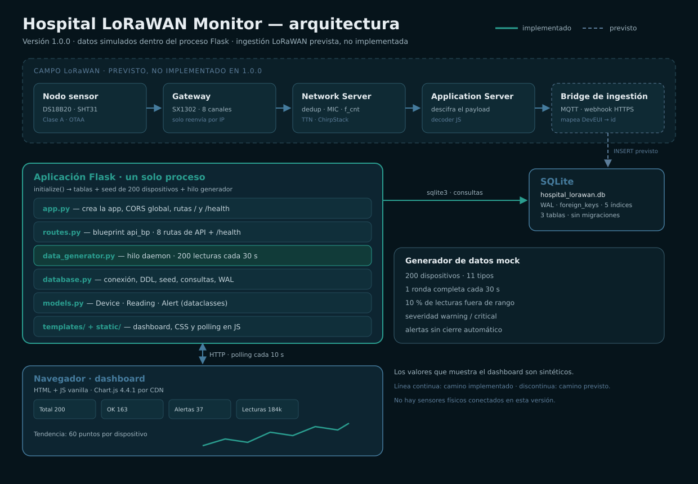

# Datasheet — Hospital LoRaWAN Monitor

**Documentación de usuario y referencia funcional · versión 1.0.0**


> **Aviso previo.** Esta versión **no lee sensores reales**. Un generador
> interno produce 200 lecturas sintéticas cada 30 segundos. Las alertas, los
> gráficos y las estadísticas son demostrativos. No uses esta herramienta para
> validar cadena de frío, liberar lotes, auditar hemoderivados ni tomar
> decisiones clínicas.

---

## Índice

1. [Resumen del producto](#1-resumen-del-producto)
2. [Especificaciones técnicas](#2-especificaciones-técnicas)
3. [Requisitos de hardware y software](#3-requisitos-de-hardware-y-software)
4. [Dependencias e instalación](#4-dependencias-e-instalación)
5. [Puesta en marcha](#5-puesta-en-marcha)
6. [Guía de usuario del dashboard](#6-guía-de-usuario-del-dashboard)
7. [Interpretación de alertas](#7-interpretación-de-alertas)
8. [Tipos de dispositivo y límites](#8-tipos-de-dispositivo-y-límites)
9. [Operación y ajustes](#9-operación-y-ajustes)
10. [Exportación de datos](#10-exportación-de-datos)
11. [Mantenimiento y retención](#11-mantenimiento-y-retención)
12. [Seguridad operativa](#12-seguridad-operativa)
13. [Preguntas frecuentes](#13-preguntas-frecuentes)
14. [Solución de problemas](#14-solución-de-problemas)
15. [Glosario](#15-glosario)
16. [Referencia rápida](#16-referencia-rápida)

---

## 1. Resumen del producto

Hospital LoRaWAN Monitor es un panel web que concentra el estado térmico y de
humedad de hasta 200 puntos de monitoreo hospitalario. Cada punto tiene un tipo
(vitrina, frigobar, freezer, cámara, sala ambiental o termostato) y un rango
operativo propio. El sistema evalúa cada lectura contra esos límites y genera
alertas con dos niveles de severidad.

| Aspecto | Descripción |
|---|---|
| Función | Visualización y alerta de temperatura/humedad |
| Usuarios | Personal de farmacia, laboratorio, nutrición, ingeniería biomédica |
| Alcance | Demostrador funcional y base para un piloto IoT |
| Datos | **Sintéticos** en 1.0.0 (generador mock) |
| Persistencia | SQLite local, sin servidor de base de datos |
| Interfaz | Una página, sin autenticación, en español |
| Despliegue | Un proceso Python; opcional Gunicorn + Nginx |

### Qué problema resuelve (en su versión real)

Un hospital mantiene decenas de equipos de frío con requisitos distintos. La
inspección manual es discontinua y no deja evidencia horaria. Este panel
propone: un nodo por equipo, telemetría periódica por radio, evaluación
automática de límites y una pantalla única para priorizar alertas.

### Qué incluye la versión 1.0.0

- Inventario de 200 dispositivos sembrado automáticamente.
- Generación de lecturas cada 30 s con 10 % de excursiones simuladas.
- API JSON de consulta y una ruta para forzar la generación.
- Dashboard con tarjetas, filtros, gráfico de tendencia y tablas.
- Esquema de base de datos con índices y WAL.

### Qué no incluye

- Sensores, gateway ni servidor de red.
- Ingestión MQTT/HTTP.
- Autenticación, roles o auditoría.
- Acuse y cierre de alertas.
- Notificaciones externas.
- Calibración trazable ni certificación.

---

## 2. Especificaciones técnicas

### 2.1 Generales

| Parámetro | Valor |
|---|---|
| Nombre | Hospital LoRaWAN Monitor |
| Versión | 1.0.0 |
| Idioma de interfaz | Español (fechas `es-CL`) |
| Framework web | Flask ≥ 3.0 |
| Base de datos | SQLite 3 (archivo local) |
| Motor de plantillas | Jinja2 |
| Frontend | HTML5, CSS3, JavaScript ES6+ |
| Gráficos | Chart.js 4.4.1 (CDN) |
| Iconos | Font Awesome 6.5.1 (CDN) |
| API | JSON sobre HTTP, sin versión en la ruta |
| Zona horaria | UTC en la base; el cliente asume UTC |
| Licencia | MIT |

### 2.2 Capacidad

| Concepto | Valor |
|---|---|
| Dispositivos sembrados | 200 |
| Tipos de dispositivo | 11 |
| Lecturas por ronda | 200 (una por dispositivo activo) |
| Intervalo de generación | 30 s |
| Intervalo de polling | 10 s |
| Lecturas por día (mock) | ~576 000 |
| Puntos en el gráfico | 60 (≈30 min) |
| Alertas mostradas | 20 más recientes no resueltas |
| Lecturas en la tabla histórica | 100 más recientes |
| Límite de dispositivos por diseño | 200 (no es un tope técnico, sí de configuración) |

### 2.3 Simulación

| Parámetro | Valor |
|---|---|
| Distribución base | Gaussiana centrada en el punto medio del rango |
| Desviación en tipos normales | 15 % del ancho del rango |
| Desviación en tipos estables | 0.3 °C absolutos |
| Probabilidad de excursión | 10 % por lectura y magnitud |
| Magnitud de la excursión | 5–30 % del rango, con mínimo de 1 °C |
| Acotado en tipos estables | ±0.5 °C fuera de los límites |
| Redondeo | 2 decimales |
| Humedad | Solo 30 dispositivos `ambiental`, 30–60 % HR |
| Severidad crítica | Desviación > 2.0 °C respecto de un límite |
| Histéresis | Ninguna |
| Persistencia temporal | Ninguna (cada lectura es independiente) |

### 2.4 Comportamiento temporal

```
t = 0 s     arranque → seed (si BD vacía) → primera ronda inmediata
t = 30 s    segunda ronda
t = 60 s    tercera ronda
...
navegador   consulta API cada 10 s (independiente del ciclo de generación)
```

No hay sincronización entre generación y polling: una misma lectura puede
verse en dos polls consecutivos, y el contador de lecturas puede avanzar 0 o
200 entre dos polls según la fase.

---

## 3. Requisitos de hardware y software

### 3.1 Servidor

| Recurso | Mínimo | Recomendado |
|---|---|---|
| CPU | 2 núcleos | 4 núcleos |
| RAM | 1 GB | 4 GB |
| Disco | 500 MB + crecimiento | 20 GB SSD |
| Sistema operativo | Linux, macOS, WSL2 | Debian 12 / Ubuntu 22.04 / Raspberry Pi OS 64-bit |
| Python | 3.10 | 3.12 |
| Red | Puerto 5000 local | Reverse proxy con TLS |

Crecimiento de disco: ~576 000 filas/día. Con uso continuo, planificar
retención a 30 días o más según criticidad.

### 3.2 Cliente

| Requisito | Detalle |
|---|---|
| Navegador | Chrome 90+, Firefox 88+, Edge 90+, Safari 14+ |
| JavaScript | Obligatorio |
| Resolución | 1280×720 mínimo; 1920×1080 óptima |
| Internet | Necesario para Chart.js y Font Awesome (CDN) |
| Red | Acceso al servidor por HTTP/HTTPS |

### 3.3 Software del servidor

- Python 3.10 o superior con `venv` y `pip`.
- `sqlite3` (incluido en la biblioteca estándar; la CLI es opcional para
  mantenimiento).
- Navegador para verificar la interfaz.
- Opcional: Gunicorn, Nginx, systemd, `curl`, `jq`.

---

## 4. Dependencias e instalación

Las dependencias de Python están declaradas en **`requirements.txt`**:

```
flask>=3.0.0
flask-cors>=4.0.0
```

| Paquete | Versión declarada | Uso |
|---|---|---|
| Flask | ≥ 3.0.0 | Servidor web, rutas, plantillas |
| Flask-CORS | ≥ 4.0.0 | Cabeceras CORS para la API |

No hay dependencias nativas, Node, ni base de datos externa. Chart.js y Font
Awesome se cargan por CDN en el navegador, por lo que no aparecen en
`requirements.txt`.

### Instalación en entorno virtual

```bash
cd versions/hospital-lorawan-dashboard

python3 -m venv venv
source venv/bin/activate        # Linux / macOS
venv\Scripts\activate           # Windows (cmd)
venv\Scripts\Activate.ps1       # Windows (PowerShell)

python -m pip install --upgrade pip
pip install -r requirements.txt

# Verificación
python -c "import flask, flask_cors; print(flask.__version__)"
```

### Comprobación de dependencias

```bash
pip list | grep -i flask
# Flask       3.x.x
# Flask-Cors  4.x.x
```

Si `pip install -r requirements.txt` falla por red, verificar proxy y índice
de paquetes. Si falla por permisos, el entorno virtual no está activo.

### Actualización

```bash
source venv/bin/activate
pip install --upgrade -r requirements.txt
```

Las versiones son mínimas (`>=`), no fijadas: una actualización mayor de Flask
podría introducir cambios. Para un piloto, fijar versiones exactas y probar.

---

## 5. Puesta en marcha

### 5.1 Arranque

```bash
python app.py
```

La aplicación:

1. Carga `config.py` y crea el directorio de trabajo lógico.
2. Crea las tablas e índices si no existen.
3. Si `devices` está vacía, siembra 200 dispositivos.
4. Lanza el hilo generador y produce la primera ronda.
5. Escucha en `0.0.0.0:5000` con debug activo.

Salida típica:

```
[INFO] Iniciando Dashboard de Monitoreo Hospitalario LoRaWAN
[INFO] Paso 1/2: Inicializando base de datos...
[INFO] Tablas de base de datos creadas/verificadas correctamente.
[INFO] Seed completado: 200 dispositivos insertados.
[INFO] Paso 2/2: Arrancando generador de datos LoRaWAN...
[INFO] Thread generador de datos iniciado.
[INFO] Sistema listo. Navega a http://localhost:5000
 * Running on all addresses (0.0.0.0)
 * Running on http://127.0.0.1:5000
```

### 5.2 Primer acceso

Abrir <http://localhost:5000>. En la primera carga se ven las 200 filas, las
tarjetas con datos y el gráfico aún vacío hasta seleccionar un dispositivo.

### 5.3 Comprobaciones inmediatas

```bash
curl -s http://localhost:5000/health
curl -s http://localhost:5000/api/stats | python -m json.tool | head -20
```

`/health` debe responder `{"status":"ok"}`. Si responde, el servidor está
activo; si el dashboard se ve vacío, el problema está en el navegador o en la
API, no en el proceso.

### 5.4 Detención

`Ctrl+C` en la terminal. El hilo generador es *daemon*: termina con el
proceso. No hay apagado ordenado ni checkpoint explícito de WAL; SQLite
recupera al siguiente arranque.

### 5.5 Reinicio limpio

```bash
# con la app detenida
rm -f hospital_lorawan.db hospital_lorawan.db-wal hospital_lorawan.db-shm
python app.py
```

Se recrean tablas, índices y los 200 dispositivos con IDs 1–200.

---

## 6. Guía de usuario del dashboard



### 6.1 Cabecera

- **Título**: identifica el sistema.
- **EN VIVO**: indicador pulsante; no verifica realmente la frescura de los
  datos, solo que el polling se ejecuta.
- **Última actualización**: hora local del navegador de la última respuesta
  exitosa.
- **Botón de refresco**: fuerza una recarga completa de datos y renderizado.

### 6.2 Tarjetas de resumen

| Tarjeta | Significado exacto |
|---|---|
| Total Dispositivos | Dispositivos con `active = 1` (200) |
| Dispositivos OK | Filas con `status = "ok"` en la respuesta actual |
| Alertas Activas | Alertas con `resolved = 0` (histórico completo) |
| Total Lecturas | Filas en `readings` desde el inicio |
| Lecturas 24h | Filas con timestamp en las últimas 24 h |

> **Cuidado con "Dispositivos OK".** No significa "equipos dentro de rango
> ahora". El servidor marca `alert` si existe **cualquier** alerta no resuelta
> para el dispositivo, aunque la lectura actual sea normal. Como las alertas
> no se cierran solas, esta tarjeta cae con el tiempo.

### 6.3 Filtros

Se aplican en el navegador sobre los datos ya cargados; no generan peticiones.

1. **Tipo**: una de las 11 categorías.
2. **Buscar**: nombre o ubicación, sin distinguir mayúsculas.
3. **Estado**: Todos / OK / Alerta.

Los tres se combinan con AND lógico. El botón activo se resalta. Para limpiar,
elegir "Todos" y borrar el texto.

### 6.4 Tabla de dispositivos

| Columna | Contenido |
|---|---|
| # | ID del dispositivo |
| Nombre | Tipo + número correlativo (`Frigobar #047`) |
| Tipo | Nombre legible de la categoría |
| Ubicación | Área asignada por el seed |
| Temp. | Última temperatura con color por desviación |
| Humedad | Última humedad o `—` |
| Estado | Badge OK / Alerta |
| Últ. Lectura | Hora local de la lectura |

Colores de temperatura: verde si está dentro del rango, ámbar si se desvía
hasta 3 °C del punto medio, rojo si se desvía más. Es una ayuda visual, no una
evaluación normativa.

Al hacer clic en el nombre se carga ese dispositivo en el gráfico.

### 6.5 Gráfico de tendencia

- Selector de dispositivo con los 200 nombres.
- Serie de temperatura en el eje izquierdo.
- Serie de humedad en el eje derecho (0–100 %), oculta para dispositivos sin
  humedad.
- 60 puntos, orden ascendente.
- Se actualiza al cambiar de dispositivo, no por polling.

Lectura correcta: buscar tendencia, no valores aislados. En el mock, los
saltos bruscos son esperables porque no se modela inercia térmica.

### 6.6 Panel de alertas

Muestra hasta 20 alertas **no resueltas**, con:

- Nombre del dispositivo.
- Fecha y hora (UTC convertida por el navegador).
- Mensaje, por ejemplo `Temperatura alta: 9.42°C (máximo: 8.0°C)`.
- Severidad: `Crítica` (rojo) o `Advertencia` (ámbar).

No hay botón de acuse. Las alertas solo desaparecen si se marcan como
resueltas por SQL o si se borra la base.

### 6.7 Últimas lecturas

Tabla con las 100 filas más recientes, independiente del filtro de
dispositivos. Útil para verificar que el generador avanza. El botón de
refresco solo recarga esta tabla.

---

## 7. Interpretación de alertas

### 7.1 Cómo se generan

Por cada lectura:

| Condición | Parámetro | Mensaje | Severidad |
|---|---|---|---|
| `temp < temp_min` | temperature | `Temperatura baja: X°C (mínimo: Y°C)` | warning o critical |
| `temp > temp_max` | temperature | `Temperatura alta: X°C (máximo: Y°C)` | warning o critical |
| `hum < hum_min` | humidity | `Humedad baja: X% (mínimo: Y%)` | warning |
| `hum > hum_max` | humidity | `Humedad alta: X% (máximo: Y%)` | warning |

La severidad crítica se asigna si `|valor − límite| > 2.0`, comparando contra
ambos extremos. La humedad nunca es crítica.

### 7.2 Qué significa "resuelta"

`alerts.resolved = 0` significa activa. **Ninguna parte del código la cambia a
1.** Por lo tanto:

- Una alerta de hace una semana sigue contando como activa.
- El estado del dispositivo queda en alerta de forma permanente.
- El panel de alertas se llena con eventos antiguos.

Esto es una limitación conocida de la versión 1.0.0, no un fallo de
configuración. Para cerrar alertas manualmente:

```bash
sqlite3 hospital_lorawan.db \
  "UPDATE alerts SET resolved = 1 WHERE created_at < datetime('now','-1 hour');"
```

Para una operación real se requiere un flujo de acuse con usuario, motivo y
hora, más una regla de cierre automático tras N lecturas consecutivas dentro
de rango.

### 7.3 Priorización recomendada

1. **Crítica en freezer de −80 °C**: riesgo irreversible de muestra.
2. **Crítica en banco de sangre o farmacia**: producto potencialmente perdido.
3. **Advertencia repetida en el mismo equipo**: posible puerta o calibración.
4. **Advertencia aislada en ambiental**: impacto bajo, revisar tendencia.

En datos mock, ninguna priorización tiene consecuencia real.

---

## 8. Tipos de dispositivo y límites

| # | Tipo | Cantidad | IDs | Temp. mín | Temp. máx | Humedad |
|---|---|---|---|---|---|---|
| 1 | Vitrina refrigerada | 46 | 1–46 | 2.0 °C | 8.0 °C | — |
| 2 | Frigobar | 33 | 47–79 | 2.0 °C | 8.0 °C | — |
| 3 | Refrigerador combinado (frío) | 20 | 80–99 | 2.0 °C | 8.0 °C | — |
| 4 | Refrigerador combinado (congelador) | 20 | 100–119 | −20.5 °C | −19.5 °C | — |
| 5 | Freezer −20 °C | 13 | 120–132 | −20.5 °C | −19.5 °C | — |
| 6 | Vitrina de dos puertas | 8 | 133–140 | 2.0 °C | 8.0 °C | — |
| 7 | Freezer −80 °C | 4 | 141–144 | −80.5 °C | −79.5 °C | — |
| 8 | Freezer horizontal | 4 | 145–148 | −20.5 °C | −19.5 °C | — |
| 9 | Cámara mortuoria | 2 | 149–150 | 2.0 °C | 8.0 °C | — |
| 10 | Área ambiental | 30 | 151–180 | 20.0 °C | 24.0 °C | 30–60 % |
| 11 | Termostato con sonda | 20 | 181–200 | −50.0 °C | 100.0 °C | — |

Los IDs son estables mientras no se borre la base: el seed recorre
`DEVICE_TYPES` en orden de inserción con un contador global. El tipo
`ambiental` es el único con humedad.

### Nombres y ubicaciones

- Formato: `{Nombre visible} #{contador:03d}`. Ejemplo: `Freezer -80°C #141`.
- Ubicaciones: rotación de áreas por tipo (Pasillo A/B, Farmacia Central,
  Quirófanos, UCI, Laboratorio, Banco de Sangre, Cocina, Almacén Frío, Morgue,
  Calderas, etc.).
- No hay unicidad garantizada de nombre: el contador es global.

---

## 9. Operación y ajustes

### 9.1 Forzar una ronda

```bash
curl -X POST http://localhost:5000/api/generate \
     -H "Content-Type: application/json" -d '{}'
```

Respuesta: `{"success": true, "message": "Generadas 200 lecturas correctamente.", "count": 200}`.

Sin `Content-Type` correcto devuelve HTTP 415. Es el endpoint más útil para
demos y el más peligroso en producción (escritura sin autenticación).

### 9.2 Cambiar la frecuencia

En `config.py`:

```python
GENERATION_INTERVAL = 30   # segundos
POLLING_INTERVAL = 10      # el frontend usa 10000 ms fijos en dashboard.js
```

`POLLING_INTERVAL` existe en la configuración del servidor, pero el intervalo
real del navegador está codificado en `static/js/dashboard.js`
(`POLL_INTERVAL = 10000`). Cambiarlo en `config.py` no afecta al frontend.

### 9.3 Cambiar la probabilidad de excursión

```python
OUT_OF_RANGE_PROBABILITY = 0.10   # 0.0 a 1.0
```

Valores útiles: `0.0` para una demo sin alertas, `0.3` para mostrar saturación,
`1.0` para pruebas de estrés visual.

### 9.4 Cambiar la cantidad de dispositivos

Editar `count` de cada entrada en `DEVICE_TYPES` **y recrear la base**. El seed
solo corre si `devices` está vacía. Si se agrega un tipo nuevo, también hay que
mapear su nombre en `formatDeviceType()` del JS y, opcionalmente, en
`locations_by_type`.

### 9.5 Añadir un dispositivo manual

No hay endpoint de alta. Se puede insertar por SQL:

```sql
INSERT INTO devices (device_type, name, location, temp_min, temp_max)
VALUES ('frigobar', 'Frigobar Nuevo', 'UCI', 2.0, 8.0);
```

El generador lo incluirá en la siguiente ronda. La API lo listará de inmediato.

---

## 10. Exportación de datos

### 10.1 Desde la API

```bash
# Inventario completo
curl -s http://localhost:5000/api/devices > dispositivos.json

# Últimas 1000 lecturas
curl -s "http://localhost:5000/api/readings?limit=1000" > lecturas.json

# Alertas activas
curl -s "http://localhost:5000/api/alerts?limit=1000" > alertas.json

# Estadísticas
curl -s http://localhost:5000/api/stats > estadisticas.json
```

`limit` no está acotado: valores muy altos pueden consumir memoria y tiempo.

### 10.2 Desde SQLite

```bash
sqlite3 -header -csv hospital_lorawan.db \
 "SELECT d.name, d.device_type, d.location,
         r.temperature, r.humidity, r.timestamp
  FROM readings r JOIN devices d ON d.id = r.device_id
  WHERE r.timestamp >= datetime('now','-1 day')
  ORDER BY r.timestamp DESC;" > lecturas_24h.csv
```

### 10.3 Copia completa

```bash
sqlite3 hospital_lorawan.db ".backup 'respaldo.db'"
```

No copiar el archivo a mano con la app escribiendo: WAL puede dejar la copia
inconsistente. Detener el servicio o usar `.backup`.

---

## 11. Mantenimiento y retención

### 11.1 Rutina sugerida

| Frecuencia | Tarea |
|---|---|
| Diaria | Verificar `/health`, espacio en disco y crecimiento de la BD |
| Semanal | Respaldo con `.backup`, revisar alertas antiguas |
| Mensual | `PRAGMA integrity_check`, purga según retención, `VACUUM` |
| Por cambio | `python -m compileall -q .`, prueba manual de endpoints |

### 11.2 Retención

```sql
-- 30 días de lecturas
DELETE FROM readings WHERE timestamp < datetime('now','-30 days');

-- 90 días de alertas cerradas
DELETE FROM alerts WHERE resolved = 1 AND created_at < datetime('now','-90 days');

VACUUM;
```

`VACUUM` necesita espacio libre equivalente al tamaño de la base y bloquea
escrituras mientras corre. Programarlo fuera de horario de demo.

### 11.3 Integridad

```bash
sqlite3 hospital_lorawan.db "PRAGMA integrity_check;"
sqlite3 hospital_lorawan.db "PRAGMA foreign_key_check;"
```

### 11.4 Crecimiento

| Periodo | Filas de lecturas | Tamaño aproximado |
|---|---|---|
| 1 día | 576 000 | 60–100 MB con índices |
| 1 semana | 4.0 M | 400–700 MB |
| 1 mes | 17.3 M | 1.7–3 GB |

Son estimaciones; medir con `du -h hospital_lorawan.db` y
`SELECT COUNT(*) FROM readings`.

---

## 12. Seguridad operativa

Esta versión **no está endurecida**. Antes de exponerla fuera de un equipo
local:

1. Poner `FLASK_DEBUG = False` en `config.py`. El depurador de Werkzeug
   permite ejecución remota si el puerto es accesible.
2. Restringir CORS a los orígenes reales.
3. Escuchar en `127.0.0.1` y publicar por Nginx con TLS.
4. Añadir autenticación en el proxy (basic auth, OIDC o VPN).
5. Bloquear o proteger `POST /api/generate`.
6. Limitar el tamaño de `limit` y la tasa de peticiones.
7. No exponer la base de datos ni los archivos WAL.
8. Revisar que no haya credenciales en el repositorio (no las hay en 1.0.0).
9. Tratar la base como información interna: ubicaciones y horarios de falla
   son sensibles aunque no haya datos de pacientes.

Riesgo principal: `POST /api/generate` sin autenticación permite inflar la
base con 200 filas por petición. Un bucle trivial degrada el servicio y
distorsiona las métricas.

---

## 13. Preguntas frecuentes

**¿Los datos son reales?**
No. Los produce `data_generator.py` dentro del proceso Flask.

**¿Necesito sensores o un gateway?**
No para esta versión. El diseño de integración está en `docs/developer.md`.

**¿Por qué aparecen alertas sin que nada falle?**
Porque el 10 % de las lecturas se genera deliberadamente fuera de rango.

**¿Por qué las alertas no desaparecen?**
Porque no existe lógica de cierre. Ver [sección 7.2](#72-qué-significa-resuelta).

**¿Por qué "Dispositivos OK" baja con el tiempo?**
Porque cuenta dispositivos sin alertas pendientes, y las alertas son
permanentes.

**¿Puedo usar otra base de datos?**
No sin cambios: el código usa `sqlite3` y SQL específico. Hay una guía de
migración a PostgreSQL en `docs/developer.md`.

**¿Puedo abrir el dashboard desde otra máquina?**
Sí, escucha en `0.0.0.0:5000`. Hacerlo solo en red controlada y con proxy.

**¿Funciona sin Internet?**
El backend sí; el gráfico y los iconos no, porque provienen de CDN.

**¿Se pierde el histórico al reiniciar?**
No. La base persiste en `hospital_lorawan.db`.

**¿Cuántos dispositivos soporta?**
La configuración siembra 200. El límite práctico depende del hardware y del
volumen; por encima de 500 conviene PostgreSQL.

**¿Por qué el gráfico no se actualiza solo?**
Porque `updateChart()` solo se ejecuta al cambiar de dispositivo o al
refrescar. Es una decisión de la versión, no un error de red.

**¿Cómo elimino todas las alertas?**
`UPDATE alerts SET resolved = 1;` o borrar la base y reiniciar.

**¿Es compatible con TTN y ChirpStack?**
El diseño sí; la implementación de ingestión no está incluida.

**¿Sirve para auditoría sanitaria?**
No. No hay trazabilidad inmutable, calibración ni validación de software.

---

## 14. Solución de problemas

| Síntoma | Causa probable | Solución |
|---|---|---|
| `ModuleNotFoundError: flask` | Entorno virtual inactivo o dependencias no instaladas | Activar `venv` y `pip install -r requirements.txt` |
| `unable to open database file` | Directorio sin permiso de escritura | Ejecutar desde una ruta escribible o ajustar permisos |
| `Address already in use` | Otro proceso en el puerto 5000 | `lsof -i :5000` y detener el proceso, o cambiar `FLASK_PORT` |
| El dashboard carga sin datos | Error en la API o JS bloqueado | Abrir la consola del navegador y revisar `/api/stats` |
| Tabla vacía pero `/api/devices` responde | Filtros activos | Poner estado "Todos" y limpiar búsqueda |
| El gráfico está vacío | No hay dispositivo seleccionado | Elegir uno en el desplegable |
| Gráfico sin línea de humedad | Dispositivo sin sensor de humedad | Es el comportamiento esperado |
| Alertas duplicadas en pocos segundos | *Reloader* de debug activo | `FLASK_DEBUG = False` |
| Las lecturas no avanzan | Hilo generador detenido o excepción | Reiniciar y revisar logs |
| `database is locked` | Dos procesos escribiendo | Dejar una sola instancia |
| `disk I/O error` | Disco lleno o archivo corrupto | Liberar espacio, `PRAGMA integrity_check` |
| Fechas corridas | Cliente interpreta UTC como local | Asumir UTC; el JS agrega `Z` |
| `415` al forzar ronda | Falta `Content-Type` | Enviar `application/json` |
| Todo en alerta tras un día | Limitación de alertas permanentes | Cierre manual por SQL |
| Lentitud al abrir | Base con millones de filas | Purga, `VACUUM`, índices |

### Diagnóstico rápido

```bash
# ¿El proceso responde?
curl -i http://localhost:5000/health

# ¿Hay dispositivos?
sqlite3 hospital_lorawan.db "SELECT COUNT(*) FROM devices;"

# ¿El generador avanza?
sqlite3 hospital_lorawan.db \
  "SELECT COUNT(*), MAX(timestamp) FROM readings;"

# ¿Hay alertas?
sqlite3 hospital_lorawan.db \
  "SELECT COUNT(*) FROM alerts WHERE resolved = 0;"

# ¿La base está sana?
sqlite3 hospital_lorawan.db "PRAGMA integrity_check;"
```

---

## 15. Glosario

| Término | Definición |
|---|---|
| **LoRa** | Modulación de radio de espectro ensanchado, larga distancia y bajo consumo |
| **LoRaWAN** | Protocolo de red sobre LoRa con gateways y servidores |
| **Gateway** | Concentrador que recibe radio y reenvía por IP |
| **DevEUI** | Identificador único de 8 bytes de un nodo LoRaWAN |
| **OTAA** | Activación por aire con JoinEUI/AppKey (recomendada) |
| **ABP** | Activación por personalización; claves fijas |
| **Duty cycle** | Porcentaje máximo de tiempo de aire permitido por banda |
| **SF** | Factor de ensanchamiento (7 a 12); más SF, más alcance y menos tasa |
| **ADR** | Adaptación automática de la tasa de datos |
| **f_cnt** | Contador de tramas; protege contra replay y duplicados |
| **MQTT** | Protocolo pub/sub usado para entregar uplinks |
| **Mock** | Dato simulado, no proveniente de un sensor |
| **WAL** | Write-Ahead Logging de SQLite; permite lectores con un escritor |
| **Histéresis** | Margen para evitar que una alerta oscile alrededor del umbral |
| **Uplink/downlink** | Mensaje nodo→red / red→nodo |
| **Clase A** | Nodo que escucha solo tras transmitir; mínimo consumo |

---

## 16. Referencia rápida

### Endpoints

| Método | Ruta | Uso |
|---|---|---|
| GET | `/` | Dashboard |
| GET | `/health` | Salud del servicio |
| GET | `/api/devices` | Inventario; `device_type`, `search` |
| GET | `/api/devices/<id>` | Detalle + última lectura |
| GET | `/api/readings` | Histórico; `limit`, `device_id` |
| GET | `/api/readings/current` | Última lectura y estado por dispositivo |
| GET | `/api/readings/latest/<id>` | 60 lecturas para el gráfico |
| GET | `/api/alerts` | Alertas no resueltas |
| GET | `/api/stats` | Agregados |
| POST | `/api/generate` | Fuerza una ronda mock |

### Archivos clave

| Archivo | Función |
|---|---|
| `app.py` | Arranque, CORS, inicialización |
| `config.py` | Tipos, límites, intervalos, host/puerto |
| `database.py` | Esquema, seed, consultas |
| `data_generator.py` | Simulación y alertas |
| `models.py` | Dataclasses |
| `routes.py` | API |
| `templates/dashboard.html` | Estructura de la página |
| `static/js/dashboard.js` | Polling y renderizado |
| `static/css/dashboard.css` | Estilos |
| `requirements.txt` | Dependencias Python |

### Comandos esenciales

```bash
python3 -m venv venv && source venv/bin/activate
pip install -r requirements.txt
python app.py
curl -s http://localhost:5000/health
sqlite3 hospital_lorawan.db ".backup 'respaldo.db'"
```

### Licencia

MIT · `Copyright (c) 2026 jmadasme`. Código original de la versión 1.0.0:
Wander Cáceres H. (@wanderc137). Ver `LICENSE` en la raíz del proyecto.

Para detalle técnico, continuar en [`developer.md`](developer.md); para
fuentes y buenas prácticas, en [`REFERENCES.md`](REFERENCES.md).
