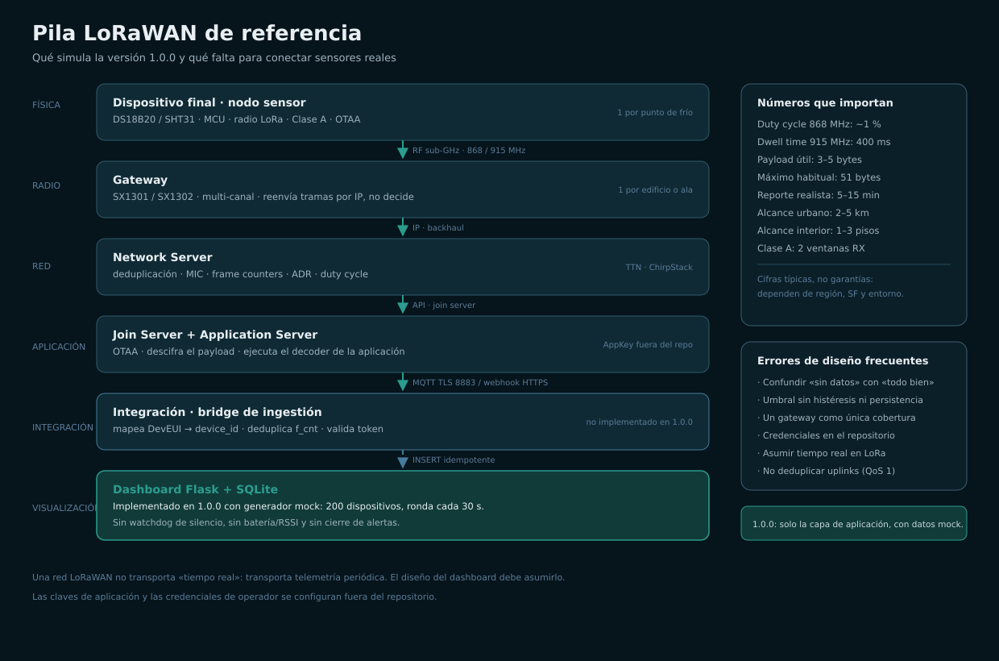

# Guía del desarrollador — Hospital LoRaWAN Monitor

**Documentación técnica interna · versión 1.0.0**


> Este documento describe el código **tal como está**. No propone refactors
> aplicados: distingue lo implementado de lo previsto. Si algo no existe en el
> repositorio, se marca explícitamente como "no implementado".

---

## Índice

1. [Propósito y alcance](#1-propósito-y-alcance)
2. [Estructura del repositorio](#2-estructura-del-repositorio)
3. [Arquitectura de ejecución](#3-arquitectura-de-ejecución)
4. [Los módulos, uno por uno](#4-los-módulos-uno-por-uno)
5. [Modelo de datos y SQL](#5-modelo-de-datos-y-sql)
6. [Contrato de la API](#6-contrato-de-la-api)
7. [Motor de simulación](#7-motor-de-simulación)
8. [Integración LoRaWAN real](#8-integración-lorawan-real)
9. [Frontend](#9-frontend)
10. [Cómo extender el sistema](#10-cómo-extender-el-sistema)
11. [Pruebas y depuración](#11-pruebas-y-depuración)
12. [Rendimiento y escalado](#12-rendimiento-y-escalado)
13. [Revisión de seguridad del código](#13-revisión-de-seguridad-del-código)
14. [Operación y despliegue](#14-operación-y-despliegue)
15. [Convenciones y deuda técnica](#15-convenciones-y-deuda-técnica)
16. [API interna de referencia](#16-api-interna-de-referencia)
17. [Referencias](#17-referencias)

---

## 1. Propósito y alcance

El proyecto es un dashboard de cadena de frío hospitalaria con dos capas
diferenciadas:

| Capa | Estado | Dónde |
|---|---|---|
| Aplicación web + API + persistencia | Implementada | `app.py`, `routes.py`, `database.py` |
| Simulación de 200 sensores | Implementada | `data_generator.py` |
| Ingestión LoRaWAN real | Diseñada, no implementada | Este documento, sección 8 |

El objetivo técnico de 1.0.0 es demostrar el flujo completo de datos
(dispositivo → lectura → evaluación → alerta → visualización) sin depender de
hardware. La simulación es de primera clase: corre en un hilo propio, escribe
en la misma base que usaría una fuente real y produce los mismos tipos de
alerta.

### Principios que sigue el código

- **Sin ORM ni migraciones**: SQL explícito, esquema creado con
  `CREATE TABLE IF NOT EXISTS`.
- **Sin build de frontend**: un HTML, un CSS y un JS; librerías por CDN.
- **Configuración centralizada** en `config.py` (no hay `.env` ni variables de
  entorno).
- **Un proceso**: el generador es un hilo del mismo proceso Flask.
- **Respuestas uniformes**: `{success, data, count}` o `{success, error}`.

### Principios que **no** sigue

- No hay separación por capas formales (servicios/repositorios): las rutas
  consultan la base directamente.
- No hay inyección de dependencias: los módulos se importan entre sí.
- No hay tests automatizados ni CI.
- No hay control de versiones del esquema.

---

## 2. Estructura del repositorio

```
hospital-lorawan/
├── README.md
├── LICENSE
├── docs/
│   ├── datasheet.md
│   ├── developer.md          ← este documento
│   ├── REFERENCES.md
│   └── assets/
│       ├── architecture.svg
│       ├── data-flow.svg
│       └── lorawan-stack.svg
└── versions/
    └── hospital-lorawan-dashboard/
        ├── app.py
        ├── config.py
        ├── database.py
        ├── data_generator.py
        ├── models.py
        ├── routes.py
        ├── requirements.txt
        ├── README.md
        ├── VERSION.md
        ├── .gitignore
        ├── templates/
        │   └── dashboard.html
        ├── static/
        │   ├── css/dashboard.css
        │   └── js/dashboard.js
        └── docs/
            ├── datasheet.md
            └── developer.md
```

`versions/hospital-lorawan-dashboard/` es un snapshot preservado. La
documentación de portada vive en `docs/` de la raíz; el código no se modifica
al documentar.

### Archivos generados en tiempo de ejecución

| Archivo | Origen | Versionado |
|---|---|---|
| `hospital_lorawan.db` | SQLite al primer arranque | No (`.gitignore`) |
| `hospital_lorawan.db-wal` | Modo WAL | No |
| `hospital_lorawan.db-shm` | Memoria compartida de WAL | No |
| `__pycache__/` | Intérprete | No |
| `venv/` | Entorno virtual | No |

---

## 3. Arquitectura de ejecución

### 3.1 Proceso único con dos hilos

```
Proceso Python
├── Hilo principal (Werkzeug / Gunicorn)
│   ├── atiende HTTP
│   ├── sirve templates y static
│   └── ejecuta rutas de api_bp
└── Hilo generador (daemon)
    ├── duerme 30 s
    ├── recorre 200 dispositivos
    ├── inserta lecturas
    └── evalúa límites y crea alertas
```

No hay colas, workers ni locks explícitos. La coordinación se apoya en SQLite:
WAL permite leer mientras se escribe; un solo escritor a la vez.

### 3.2 Arranque

`app.py` se ejecuta como script. Bajo `if __name__ == "__main__"`:

```python
initialize()
app.run(host=FLASK_HOST, port=FLASK_PORT, debug=FLASK_DEBUG)
```

`initialize()` hace dos cosas:

```python
database.initialize_database()
data_generator.start_generator()
```

Orden importante: las tablas y el seed deben existir antes de que el hilo
genere la primera lectura.

### 3.3 Ciclo de una petición

```
Navegador → Flask router → blueprint api_bp → función de ruta
         → database.query_* / execute → sqlite3 → dict → jsonify
```

Cada función abre una conexión nueva (`get_connection()`), ejecuta y cierra.
No hay pooling ni conexión global. `sqlite3.Row` permite acceder por nombre y
convertir a `dict` con `dict(row)`.

### 3.4 Ciclo del generador

```
start_generator()
  └── Thread(target=_generator_loop, daemon=True).start()

_generator_loop()
  while _running:
      generate_all_readings()
      time.sleep(GENERATION_INTERVAL)
```

La primera ronda es inmediata (no espera 30 s). `stop_generator()` pone
`_running = False`, pero no se invoca desde ninguna ruta ni señal.

### 3.5 Consecuencia del *reloader*

Con `debug=True`, Werkzeug arranca un proceso padre y un hijo. El módulo se
importa dos veces y `initialize()` corre en ambos si se ejecuta como script;
el resultado son dos hilos generadores y rondas duplicadas durante los
primeros segundos (el padre no sirve HTTP pero sí escribe). Para demos:
`FLASK_DEBUG = False`.

### 3.6 Consecuencia de Gunicorn

`gunicorn app:app` importa el módulo, pero **no** ejecuta el bloque
`__main__`; por lo tanto no llama a `initialize()`. Opciones:

1. Crear la base con un arranque previo de `python app.py` (sin generación
   bajo Gunicorn).
2. Añadir un `wsgi.py`:

```python
# wsgi.py — no incluido en 1.0.0
from app import app, initialize

initialize()
```

Con `--workers 1`. Más de un worker implica más de un generador.

---

## 4. Los módulos, uno por uno

### 4.1 `app.py`

| Elemento | Detalle |
|---|---|
| `app = Flask(__name__)` | Rutas de templates/static relativas al paquete |
| `CORS(app)` | Habilita CORS para todos los orígenes y rutas |
| `app.config.from_pyfile("config.py")` | Carga constantes en mayúsculas |
| `logging.basicConfig(level=INFO)` | Formato con hora, nivel y mensaje |
| `app.register_blueprint(api_bp)` | Prefijo vacío: las rutas ya incluyen `/api` |
| `GET /` | `render_template("dashboard.html")` |
| `GET /health` | JSON con estado, servicio y versión |
| `initialize()` | Base + generador |
| `__main__` | `initialize()` + `app.run(...)` |

La función `initialize()` está definida en `app.py` y no se exporta en
`__all__`; cualquier integración que la necesite debe importarla
explícitamente.

### 4.2 `config.py`

Constantes de módulo, sin clases ni validación.

```python
BASE_DIR = os.path.dirname(os.path.abspath(__file__))
DB_PATH = os.path.join(BASE_DIR, "hospital_lorawan.db")

GENERATION_INTERVAL = 30
POLLING_INTERVAL = 10
LATEST_READINGS_COUNT = 60
ALERTS_DISPLAY_COUNT = 20
RECENT_READINGS_COUNT = 100
OUT_OF_RANGE_PROBABILITY = 0.10
```

| Constante | Consumidor real | Observación |
|---|---|---|
| `DB_PATH` | `database.py` | Ruta absoluta al lado de los `.py` |
| `GENERATION_INTERVAL` | `data_generator.py` | Segundos de espera entre rondas |
| `POLLING_INTERVAL` | Nadie | El JS usa `POLL_INTERVAL = 10000` |
| `LATEST_READINGS_COUNT` | `routes.py` | Puntos del gráfico |
| `ALERTS_DISPLAY_COUNT` | `routes.py` | Límite por defecto de alertas |
| `RECENT_READINGS_COUNT` | `routes.py` | Límite por defecto de lecturas |
| `OUT_OF_RANGE_PROBABILITY` | `data_generator.py` | Probabilidad de excursión |
| `FLASK_HOST/PORT/DEBUG` | `app.py` | `0.0.0.0`, `5000`, `True` |

`DEVICE_TYPES` es un `dict` ordenado (Python 3.7+) con 11 entradas. El orden
determina los IDs del seed. Cada entrada tiene:

```python
"freezer_80": {
    "count": 4,
    "temp_min": -80.5,
    "temp_max": -79.5,
    "display_name": "Freezer -80°C",
}
```

Solo `ambiental` agrega `humidity_min` y `humidity_max`. El generador consulta
esos campos con `.get()`, por lo que su ausencia es válida.

**No hay validación** de que `temp_min < temp_max`, de que los conteos sumen
200 ni de que las claves sean únicas. Un error de edición se descubre al ver
datos incoherentes.

### 4.3 `models.py`

Tres dataclasses con `to_dict()` basado en `dataclasses.asdict()`.

```python
@dataclass
class Device:
    id: Optional[int]
    device_type: str
    name: str
    location: Optional[str]
    temp_min: float
    temp_max: float
    humidity_min: Optional[float] = None
    humidity_max: Optional[float] = None
    active: int = 1

@dataclass
class Reading:
    id: Optional[int]
    device_id: int
    temperature: float
    humidity: Optional[float]
    timestamp: Optional[str] = None

@dataclass
class Alert:
    id: Optional[int]
    device_id: int
    reading_id: Optional[int]
    parameter: str
    value: float
    min_limit: Optional[float]
    max_limit: Optional[float]
    message: str
    severity: str = "warning"
    resolved: int = 0
    created_at: Optional[str] = None
```

Uso real: los modelos se emplean para **construir** objetos antes de insertar
y para tipar helpers (`_dict_to_device`). Las consultas devuelven `dict`, no
instancias. No hay serialización personalizada ni validación.

### 4.4 `database.py`

#### Conexión

```python
def get_connection() -> sqlite3.Connection:
    conn = sqlite3.connect(DB_PATH)
    conn.row_factory = sqlite3.Row
    conn.execute("PRAGMA journal_mode=WAL")
    conn.execute("PRAGMA foreign_keys=ON")
    return conn
```

- `journal_mode=WAL` es persistente en el archivo, pero se reafirma en cada
  conexión.
- `foreign_keys=ON` es **por conexión**; sin él, las FK no se validan.
- No se define `timeout`; ante un bloqueo, SQLite espera 5 s por defecto y
  lanza `database is locked`.

#### Esquema

`create_tables()` ejecuta tres `CREATE TABLE IF NOT EXISTS` y cinco
`CREATE INDEX IF NOT EXISTS` (DDL completo en la sección 5). No hay
`ALTER`, `DROP` ni control de versión.

#### Seed

`seed_devices()`:

1. `SELECT COUNT(*) FROM devices`.
2. Si es mayor que 0, retorna sin hacer nada.
3. Recorre `DEVICE_TYPES` en orden, con un contador global que empieza en 1.
4. Por cada unidad, elige ubicación rotando la lista del tipo.
5. Inserta con `name = f"{display_name} #{counter:03d}"`.

Consecuencia: los IDs dependen del orden y de los conteos. La tabla de
`docs/datasheet.md` refleja la configuración actual. Cambiar un `count`
desplaza todos los IDs posteriores.

#### Helpers de consulta

| Función | Retorno | Notas |
|---|---|---|
| `query_all(sql, params)` | `list[dict]` | Genérico |
| `query_one(sql, params)` | `dict \| None` | Primera fila |
| `query_device(device_id)` | `dict \| None` | Por PK |
| `query_all_devices(device_type, search)` | `list[dict]` | `active=1`, filtros opcionales, `LIKE` |
| `query_latest_reading(device_id)` | `dict \| None` | Última por timestamp |
| `query_latest_readings(device_id, limit)` | `list[dict]` | Trae DESC y luego invierte |
| `query_active_alerts(device_id, limit)` | `list[dict]` | `resolved=0` |
| `execute(sql, params)` | `int` | `lastrowid` |
| `initialize_database()` | `None` | Crea tablas y siembra |

`query_latest_readings` invierte la lista para que Chart.js reciba orden
cronológico ascendente sin ordenar en el cliente.

#### Conversión de filas

`_dict_to_device`, `_dict_to_reading` y `_dict_to_alert` filtran las claves
del `dict` para construir la dataclass. Si la fila trae columnas de un `JOIN`
(`device_name`, `device_type`), se ignoran al construir el modelo, pero se
conservan en la respuesta JSON porque las rutas devuelven el `dict` original.

#### Inicialización

```python
def initialize_database() -> None:
    create_tables()
    seed_devices()
```

Idempotente por diseño: tablas con `IF NOT EXISTS` y seed condicionado al
conteo. No repara datos corruptos ni aplica cambios de esquema.

### 4.5 `data_generator.py`

#### Estado global

```python
_generator_thread: Optional[threading.Thread] = None
_running = False
```

No hay lock. `start_generator()` no comprueba si ya hay un hilo activo: dos
llamadas crean dos hilos y duplican la generación.

#### Funciones

| Función | Firma | Responsabilidad |
|---|---|---|
| `_gaussian_value` | `(center, min_val, max_val, std_dev_factor=0.15) -> float` | Gaussiana acotada y redondeada |
| `_is_temperature_stable` | `(device_type) -> bool` | Freezers y congelador combinado |
| `generate_reading_value` | `(device) -> float` | Temperatura sintética |
| `generate_humidity_value` | `(device) -> Optional[float]` | Humedad o `None` |
| `insert_reading_and_check_alerts` | `(device, temperature, humidity) -> None` | INSERT + alertas |
| `generate_all_readings` | `() -> int` | Ronda completa; devuelve el conteo |
| `_generator_loop` | `() -> None` | Bucle con `sleep` |
| `start_generator` | `() -> None` | Crea el hilo daemon |
| `stop_generator` | `() -> None` | Bandera de parada (no expuesta) |

`_gaussian_value` usa `random.gauss(center, std)` y acota con `max(min_val,
min(value, max_val))`. Si `min_val == max_val`, usa una desviación de reserva
(`abs(min_val) * 0.02 + 0.3`) para evitar `std=0`; con la configuración actual
no ocurre.

#### Inserción y alertas

```python
reading_id = execute(
    "INSERT INTO readings (device_id, temperature, humidity) VALUES (?, ?, ?)",
    (device_id, temperature, humidity),
)
```

Luego compara temperatura y, si existe rango de humedad, humedad. Cada
violación inserta una fila en `alerts` con el `reading_id` recién creado.

Severidad:

```python
severity = "critical" if (
    abs(temperature - device["temp_min"]) > 2.0
    or abs(temperature - device["temp_max"]) > 2.0
) else "warning"
```

La humedad siempre es `warning`.

#### Manejo de errores

`generate_all_readings()` captura excepciones por dispositivo y continúa con
el siguiente, registrando el error. El bucle exterior captura cualquier
excepción para no matar el hilo. No hay reintentos ni backoff.

#### Hilo

```python
def _generator_loop():
    global _running
    _running = True
    while _running:
        try:
            generate_all_readings()
        except Exception as exc:
            logger.error("Error en generador: %s", exc)
        time.sleep(GENERATION_INTERVAL)
```

La primera iteración no duerme. `stop_generator()` no espera al hilo
(`join`), así que una ronda en curso puede terminar después de la llamada.

### 4.6 `routes.py`

`api_bp = Blueprint("api", __name__)` sin `url_prefix`; cada ruta declara
`/api/...`.

Patrón de cada endpoint:

```python
@api_bp.route("/api/devices", methods=["GET"])
def get_devices():
    try:
        ...
        return jsonify({"success": True, "data": data, "count": len(data)})
    except Exception as exc:
        return jsonify({"success": False, "error": str(exc)}), 500
```

Detalles por ruta:

- **`/api/devices`**: `device_type` y `search` opcionales; `LIKE` con `%`.
- **`/api/devices/<id>`**: 404 explícito; agrega `last_reading`.
- **`/api/readings`**: `limit` (int, por defecto 100) y `device_id`; `JOIN`
  para incluir nombre y tipo.
- **`/api/readings/current`**: subconsulta para la última lectura por
  dispositivo y subconsulta para la alerta no resuelta más reciente.
  `status = "alert"` si hay `alert_id` o si la lectura actual está fuera de
  rango; si no, `"ok"`.
- **`/api/readings/latest/<id>`**: 60 filas; devuelve `data` en orden
  ascendente.
- **`/api/alerts`**: `resolved = 0`, orden por `created_at DESC`, límite 20.
- **`/api/stats`**: conteos globales, `MAX(timestamp)`, lecturas de 24 h,
  distribución por tipo y 5 alertas recientes.
- **`/api/generate`**: exige `request.is_json` o formulario; si no, 415.
  Llama a `generate_all_readings()` y responde con el conteo.

No se usa `abort()` ni manejadores de error globales; cada ruta repite el
`try/except`.

### 4.7 `templates/dashboard.html`

Plantilla Jinja2 **sin variables**: todo el contenido es estático y el JS
rellena los datos por API. Se carga con `render_template`, lo que permite
usar `url_for('static', ...)`. Incluye:

- Meta viewport y favicon embebido (emoji).
- CDN de Font Awesome 6.5.1 y Chart.js 4.4.1.
- Cabecera, tarjetas, filtros, gráfico, tabla, alertas, histórico y footer.
- `defer` para el script propio.

Riesgo: si el CDN falla, `Chart` no existe y el gráfico lanza error; la tabla
sigue funcionando si el JS no aborta antes.

### 4.8 `static/js/dashboard.js`

Estado:

```js
const POLL_INTERVAL = 10000;
const state = {
  currentReadings: [],
  alerts: [],
  stats: {},
  statusFilter: "all",
  chart: null,
  isFirstLoad: true
};
```

| Función | Rol |
|---|---|
| `loadInitialData` | `Promise.all` de stats, dispositivos y lecturas; luego primer poll |
| `pollData` | `Promise.all` de `/current`, `/alerts`, `/stats` |
| `fetchStats` | Pinta las 5 tarjetas |
| `fetchDevicesForSelect` | Rellena el selector del gráfico |
| `fetchAndRenderReadings` | Carga 100 lecturas y pinta la tabla |
| `getOrCreateChart` | Crea Chart.js con dos ejes |
| `updateChart` | Consulta 60 puntos y actualiza datasets |
| `renderDevicesTable` | Reescribe `innerHTML` y aplica filtros |
| `renderAlerts` | Pinta severidad y mensaje |
| `renderReadingsTable` | Histórico |
| `applyFilters` | Filtra en cliente por tipo/texto/estado |
| `setStatusFilter` | Cambia el filtro de estado |
| `selectDeviceForChart` | Sincroniza tabla y gráfico |
| `refreshData` / `refreshReadings` | Refresco manual |
| `updateFooterClock` | Reloj local `es-CL` |
| `formatDeviceType` | Traduce claves a nombres legibles |

Detalles finos:

- Los timestamps llegan sin zona; el JS concatena `"Z"` antes de `new Date`.
- El dataset de humedad se oculta si todos los valores son `null`.
- `renderDevicesTable` reconstruye la tabla completa en cada poll: se pierde
  el foco y la selección de texto.
- Los filtros no consultan la API; trabajan sobre `state.currentReadings`.
- `formatDeviceType` tiene un mapa fijo; un tipo nuevo sin entrada muestra la
  clave cruda.

### 4.9 `static/css/dashboard.css`

Variables en `:root`:

```css
--primary: #1565C0;
--secondary: #00897B;
--success: #2E7D32;
--danger: #C62828;
--warning: #F57C00;
--bg: #F5F7FA;
```

Incluye grid de tarjetas, tablas con `position: sticky`, badges, animaciones
(`pulse`, `fadeIn`, `spin`) y *media queries* en 1024, 768 y 480 px. No usa
preprocesador ni framework.

---

## 5. Modelo de datos y SQL

### 5.1 DDL

```sql
CREATE TABLE IF NOT EXISTS devices (
    id            INTEGER PRIMARY KEY AUTOINCREMENT,
    device_type   TEXT NOT NULL,
    name          TEXT NOT NULL,
    location      TEXT,
    temp_min      REAL NOT NULL,
    temp_max      REAL NOT NULL,
    humidity_min  REAL,
    humidity_max  REAL,
    active        INTEGER DEFAULT 1
);

CREATE TABLE IF NOT EXISTS readings (
    id          INTEGER PRIMARY KEY AUTOINCREMENT,
    device_id   INTEGER NOT NULL,
    temperature REAL NOT NULL,
    humidity    REAL,
    timestamp   DATETIME DEFAULT CURRENT_TIMESTAMP,
    FOREIGN KEY (device_id) REFERENCES devices(id)
);

CREATE TABLE IF NOT EXISTS alerts (
    id         INTEGER PRIMARY KEY AUTOINCREMENT,
    device_id  INTEGER NOT NULL,
    reading_id INTEGER,
    parameter  TEXT NOT NULL,
    value      REAL NOT NULL,
    min_limit  REAL,
    max_limit  REAL,
    message    TEXT NOT NULL,
    severity   TEXT DEFAULT 'warning',
    resolved   INTEGER DEFAULT 0,
    created_at DATETIME DEFAULT CURRENT_TIMESTAMP,
    FOREIGN KEY (device_id) REFERENCES devices(id)
);
```

Índices:

```sql
CREATE INDEX IF NOT EXISTS idx_readings_device_id ON readings(device_id);
CREATE INDEX IF NOT EXISTS idx_readings_timestamp ON readings(timestamp);
CREATE INDEX IF NOT EXISTS idx_alerts_device_id   ON alerts(device_id);
CREATE INDEX IF NOT EXISTS idx_alerts_resolved    ON alerts(resolved);
CREATE INDEX IF NOT EXISTS idx_alerts_created_at  ON alerts(created_at);
```

### 5.2 Decisiones del esquema

| Decisión | Motivo | Coste |
|---|---|---|
| `reading_id` sin FK | Evitar conflicto al insertar alerta tras lectura | Enlace lógico no validado |
| Límites copiados en `devices` | Cada equipo conserva su rango histórico | Cambiar config no actualiza filas |
| `resolved` entero | Simple y compatible | Sin fecha de cierre ni usuario |
| Sin `CHECK` | Menos fricción en demo | Datos inválidos posibles |
| WAL | Lectores concurrentes | Tres archivos y checkpoints |
| `AUTOINCREMENT` | IDs monótonos | Ligero overhead |

### 5.3 Consultas representativas

Última lectura por dispositivo (usada en `/current`):

```sql
SELECT r.* FROM readings r
WHERE r.id = (
    SELECT r2.id FROM readings r2
    WHERE r2.device_id = r.device_id
    ORDER BY r2.timestamp DESC, r2.id DESC
    LIMIT 1
);
```

En la implementación real se resuelve con `LEFT JOIN` y subconsultas
correlacionadas; el efecto es el mismo. El índice `(device_id)` sostiene la
búsqueda, aunque el orden por `timestamp` agrega trabajo.

Estadísticas:

```sql
SELECT COUNT(*) FROM readings;
SELECT COUNT(*) FROM readings
 WHERE timestamp >= datetime('now', '-24 hours');
SELECT device_type, COUNT(*) FROM devices
 WHERE active = 1 GROUP BY device_type;
```

### 5.4 Crecimiento y mantenimiento

Sin retención, la tabla `readings` crece ~576 000 filas/día. Los índices
aumentan el tamaño y el coste de inserción. Recomendaciones en
`docs/datasheet.md` (sección 11).

### 5.5 Migraciones (no implementadas)

No hay `PRAGMA user_version` ni scripts. Para evolucionar el esquema:

1. Añadir `PRAGMA user_version = N` en `create_tables()`.
2. Al arrancar, leer la versión y aplicar `ALTER TABLE` incrementales.
3. Respaldo previo obligatorio.

Ejemplo de patrón:

```python
def migrate(conn):
    version = conn.execute("PRAGMA user_version").fetchone()[0]
    if version < 1:
        conn.execute("ALTER TABLE devices ADD COLUMN dev_eui TEXT")
        conn.execute("CREATE UNIQUE INDEX idx_devices_eui ON devices(dev_eui)")
        conn.execute("PRAGMA user_version = 1")
    conn.commit()
```

No está en el código: es una guía para una futura versión.

---

## 6. Contrato de la API

### 6.1 Convenciones

- Base: `http://host:5000`.
- JSON UTF-8.
- Éxito: `{"success": true, "data": ..., "count": N}` (el `count` no siempre
  está presente).
- Error: `{"success": false, "error": "texto"}`.
- Sin autenticación ni versionado.
- Timestamps `YYYY-MM-DD HH:MM:SS` en UTC, sin sufijo.

### 6.2 Endpoints

#### `GET /health`

```json
{"status": "ok", "service": "Hospital LoRaWAN Dashboard", "version": "1.0.0"}
```

No consulta la base: responde aunque SQLite esté corrupto. Para un chequeo
real, usar `/api/stats`.

#### `GET /api/devices`

Parámetros: `device_type` (clave exacta), `search` (texto libre).
Orden: `device_type, id`. Solo `active = 1`.

```json
{
  "success": true,
  "count": 4,
  "data": [
    {
      "id": 141, "device_type": "freezer_80",
      "name": "Freezer -80°C #141", "location": "Banco de Sangre",
      "temp_min": -80.5, "temp_max": -79.5,
      "humidity_min": null, "humidity_max": null, "active": 1
    }
  ]
}
```

#### `GET /api/devices/<id>`

Igual que una fila del listado más `last_reading` (objeto o `null`). 404 si no
existe.

#### `GET /api/readings`

Parámetros: `limit` (int, defecto 100), `device_id` (int).
`JOIN` con `devices`; cada fila incluye `device_name` y `device_type`.

#### `GET /api/readings/current`

Una fila por dispositivo activo, con `status` y datos de alerta. Es el
endpoint más pesado y el que alimenta la tabla principal.

#### `GET /api/readings/latest/<id>`

60 filas ascendentes. Sin 404 si el dispositivo no existe: devuelve lista
vacía. El frontend lo interpreta como "sin datos".

#### `GET /api/alerts`

`resolved = 0`, `ORDER BY created_at DESC`, `limit` por defecto 20,
`device_id` opcional. Incluye `device_name` y `device_type`.

#### `GET /api/stats`

```json
{
  "total_devices": 200,
  "devices_with_alerts": 37,
  "total_readings": 184320,
  "total_alerts": 4211,
  "last_update": "2026-06-10 14:30:00",
  "readings_24h": 184320,
  "type_distribution": [{"device_type": "ambiental", "count": 30}],
  "recent_alerts": []
}
```

`devices_with_alerts` cuenta dispositivos distintos con alertas no resueltas.
`total_alerts` cuenta todas las alertas históricas.

#### `POST /api/generate`

Requiere `Content-Type: application/json` (cuerpo ignorado) o
`application/x-www-form-urlencoded`. Cualquier otro tipo devuelve 415.

```json
{"success": true, "message": "Generadas 200 lecturas correctamente.", "count": 200}
```

### 6.3 Matriz de errores

| Situación | HTTP | Cuerpo |
|---|---|---|
| ID inexistente | 404 | `{"success": false, "error": "Dispositivo no encontrado"}` |
| Content-Type inválido | 415 | mensaje explicativo |
| Excepción no controlada | 500 | `{"success": false, "error": "<str(e)>"}` |
| Ruta desconocida | 404 | HTML de Flask (no JSON) |

No hay 400 para parámetros inválidos: `limit=abc` se convierte en el valor por
defecto o provoca un 500 según el caso. No hay 405 personalizado.

---

## 7. Motor de simulación

### 7.1 Objetivo

Generar series verosímiles para 11 tipos de equipo, con excursiones
suficientes para probar la UI y la lógica de alertas, sin modelar física real.

### 7.2 Temperatura

```
rango = temp_max - temp_min
centro = (temp_max + temp_min) / 2

si uniform(0,1) < 0.10:
    delta = uniform(0.05, 0.30) * max(rango, 1.0)
    valor = temp_max + delta    (50 %)
          = temp_min - delta    (50 %)
sino si tipo estable:
    valor = gauss(centro, 0.3)
    valor = clamp(valor, temp_min - 0.5, temp_max + 0.5)
sino:
    valor = gauss(centro, 0.15 * rango)
    valor = clamp(valor, temp_min, temp_max)

valor = round(valor, 2)
```

Propiedades:

- **Sin memoria**: cada lectura es independiente; no hay tendencia ni
  autocorrelación.
- **Sin histéresis**: un valor justo en el límite alterna alertas.
- **Sesgo en freezers**: el clamp de ±0.5 permite valores fuera de rango
  incluso en el 90 % "normal", elevando la tasa efectiva de alerta.
- **Rango estrecho**: en −20.5/−19.5 el `max(rango, 1.0)` hace que la
  excursión mínima sea 0.05 °C, suficiente para cruzar el límite.

### 7.3 Humedad

Solo si `humidity_min` y `humidity_max` existen:

```
si uniform(0,1) < 0.10:
    delta = uniform(0.05, 0.30) * max(rango, 1.0)
    valor = hum_max + delta o hum_min - delta
sino:
    valor = gauss(centro, 0.10 * rango)
valor = clamp(valor, 0, 100); round 2
```

### 7.4 Alertas

Por cada lectura se evalúan hasta cuatro condiciones. El mensaje se construye
con formato de un decimal (`X°C`, `Y°C`), mientras el valor almacenado
conserva dos decimales. Pequeñas diferencias de redondeo son normales.

La severidad se calcula una vez por temperatura; si se generan dos alertas
(baja y alta) no ocurre en la práctica, porque el valor no puede violar ambos
extremos a la vez salvo rango invertido.

### 7.5 Reproducibilidad

No se llama a `random.seed()`. Dos ejecuciones producen series distintas. Para
pruebas deterministas:

```python
import random
random.seed(1234)   # antes de la primera ronda
```

No hay soporte de configuración para esto; es una intervención manual.

### 7.6 Coste

Cada ronda abre una conexión y ejecuta 200 INSERT más los INSERT de alertas.
No se usa `executemany` ni transacción única por ronda: cada `execute` hace
commit implícito según la implementación del helper. Optimizar a una
transacción por ronda reduciría el coste de I/O de forma notable.

---

## 8. Integración LoRaWAN real

Esta sección es **diseño**, no código presente. Sirve como hoja de ruta para
convertir el demostrador en un piloto.



### 8.1 Cambios mínimos en el esquema

```sql
ALTER TABLE devices ADD COLUMN dev_eui TEXT;
CREATE UNIQUE INDEX idx_devices_dev_eui ON devices(dev_eui);

CREATE TABLE processed_uplinks (
    dev_eui     TEXT NOT NULL,
    f_cnt       INTEGER NOT NULL,
    received_at DATETIME DEFAULT CURRENT_TIMESTAMP,
    PRIMARY KEY (dev_eui, f_cnt)
);
```

`dev_eui` permite mapear el nodo al dispositivo interno. La tabla de
procesados evita duplicados por QoS 1 o por reenvío entre gateways.

### 8.2 Contrato de payload

Ejemplo de 5 bytes:

| Byte | Campo | Codificación |
|---|---|---|
| 0–1 | Temperatura | int16 big-endian, centésimas de °C |
| 2 | Humedad | uint8, % HR |
| 3 | Batería | uint8, décimas de V |
| 4 | Flags | bit 0 puerta, bit 1 falla |

Decoder TTN:

```js
function decodeUplink(input) {
  const b = input.bytes;
  const raw = (b[0] << 8) | b[1];
  const temperature = (raw & 0x8000 ? raw - 0x10000 : raw) / 100;
  return {
    data: {
      temperature,
      humidity: b[2],
      battery_v: b[3] / 10,
      door_open: !!(b[4] & 0x01),
      fault: !!(b[4] & 0x02)
    },
    warnings: [], errors: []
  };
}
```

Validar en el servidor: rangos físicos, longitud del payload y tipos. Un
decoder no es una frontera de confianza.

### 8.3 Bridge MQTT

Esqueleto con `paho-mqtt` (agregar a `requirements.txt` si se implementa):

```python
import json, os, sqlite3
import paho.mqtt.client as mqtt

BROKER = os.environ.get("MQTT_HOST", "eu1.cloud.thethings.network")
PORT   = int(os.environ.get("MQTT_PORT", "8883"))
USER   = os.environ["MQTT_USER"]
PASS   = os.environ["MQTT_PASS"]
TOPIC  = os.environ["MQTT_TOPIC"]          # v3/{app}/devices/+/up

def on_connect(client, userdata, flags, rc, properties=None):
    client.subscribe(TOPIC, qos=1)

def on_message(client, userdata, msg):
    event = json.loads(msg.payload)
    ids = event.get("end_device_ids", {})
    dev_eui = ids.get("dev_eui")
    decoded = event.get("uplink_message", {}).get("decoded_payload") or {}
    f_cnt = event.get("uplink_message", {}).get("f_cnt")
    if not dev_eui or "temperature" not in decoded:
        return
    ingest(dev_eui, decoded, f_cnt)

def ingest(dev_eui, decoded, f_cnt):
    conn = sqlite3.connect(os.environ["DB_PATH"])
    try:
        device = conn.execute(
            "SELECT id, temp_min, temp_max, humidity_min, humidity_max "
            "FROM devices WHERE dev_eui = ? AND active = 1", (dev_eui,)
        ).fetchone()
        if not device:
            return
        try:
            conn.execute(
                "INSERT INTO processed_uplinks (dev_eui, f_cnt) VALUES (?, ?)",
                (dev_eui, f_cnt),
            )
        except sqlite3.IntegrityError:
            return  # duplicado
        conn.execute(
            "INSERT INTO readings (device_id, temperature, humidity) VALUES (?, ?, ?)",
            (device[0], decoded["temperature"], decoded.get("humidity")),
        )
        conn.commit()
    finally:
        conn.close()

client = mqtt.Client(mqtt.CallbackAPIVersion.VERSION2)
client.username_pw_set(USER, PASS)
client.tls_set()               # CA del sistema; nunca 1883 en abierto
client.on_connect = on_connect
client.on_message = on_message
client.connect(BROKER, PORT, 60)
client.loop_forever()
```

Puntos críticos:

- **Idempotencia**: la PK `(dev_eui, f_cnt)` es la barrera. Sin ella, QoS 1
  duplica filas.
- **`f_cnt`**: si no viene, usar el `time` del servidor de red y una ventana de
  deduplicación, o una tabla de hashes.
- **Reconexión**: `loop_forever` reconecta, pero hay que re-suscribir en
  `on_connect`.
- **Persistencia de sesión**: MQTT limpio pierde mensajes mientras el bridge
  está caído. Para un piloto, `clean_session=False` y QoS 1.
- **Backpressure**: si la base se bloquea, el cliente acumula mensajes en
  memoria. Procesar en lote o usar una cola.

### 8.4 Webhook HTTPS

Alternativa sin broker: el servidor de red hace `POST` a un endpoint propio.

Requisitos de diseño:

1. Ruta `POST /ingest` en un blueprint separado.
2. Token compartido en cabecera (`X-Ingest-Token`), comparado con
   `hmac.compare_digest`.
3. Límite de cuerpo (por ejemplo, 16 KB).
4. Validación del `dev_eui` y del payload.
5. Respuesta 202 rápida; el trabajo pesado, fuera del ciclo de request.
6. Registro de `deduplication_id` para descartar reenvíos.
7. *Rate limit* por IP y por `dev_eui`.

Nada de esto está implementado; el dashboard no tiene ruta de ingestión.

### 8.5 Desactivar el mock

```python
def initialize() -> None:
    database.initialize_database()
    if os.environ.get("ENABLE_MOCK", "0") == "1":
        data_generator.start_generator()
```

Sin este cambio, el generador y el bridge escriben a la vez y las métricas
dejan de ser interpretables. Es la primera modificación a aplicar en un
piloto.

### 8.6 Watchdog de silencio

Complemento imprescindible:

```sql
SELECT d.id, d.name, MAX(r.timestamp) AS last_seen
FROM devices d
LEFT JOIN readings r ON r.device_id = d.id
WHERE d.active = 1
GROUP BY d.id
HAVING last_seen IS NULL
    OR last_seen < datetime('now', '-30 minutes');
```

Convertir el resultado en alertas `warning` con un job periódico. Sin esto,
"sin datos" se confunde con "todo bien".

### 8.7 Comparación de escenarios

| Tema | Mock 1.0.0 | Producción |
|---|---|---|
| Latencia | 0–30 s | 5–15 min |
| Duplicados | No | Sí |
| Silencios | No | Sí |
| Calidad | Perfecta | Deriva y ruido |
| Volumen | Constante | Variable |
| Reloj | Servidor | Servidor de red |
| Seguridad | Ninguna | TLS + tokens |

---

## 9. Frontend

### 9.1 Flujo de carga

```
DOMContentLoaded
  └── loadInitialData()
        ├── fetchStats()               → tarjetas
        ├── fetchDevicesForSelect()    → selector del gráfico
        ├── fetchAndRenderReadings()   → tabla histórica
        └── pollData()                 → tabla principal + alertas + tarjetas
setInterval(pollData, 10000)
setInterval(updateFooterClock, 1000)
```

### 9.2 Gráfico

```js
new Chart(ctx, {
  type: "line",
  data: { labels: [], datasets: [
    { label: "Temperatura (°C)", borderColor: "#1E88E5", yAxisID: "y" },
    { label: "Humedad (%)", borderColor: "#26A69A", yAxisID: "y1" }
  ]},
  options: {
    responsive: true,
    interaction: { mode: "index", intersect: false },
    scales: {
      y:  { position: "left" },
      y1: { position: "right", min: 0, max: 100, grid: { drawOnChartArea: false } }
    },
    elements: { line: { tension: 0.3 } }
  }
});
```

`updateChart()` solo se invoca desde `selectDeviceForChart` y desde el evento
`change` del selector. No hay actualización periódica del gráfico.

### 9.3 Renderizado de tablas

`renderDevicesTable()` construye un string HTML y lo asigna a `innerHTML`.
Ventajas: simple y rápido de escribir. Desventajas:

- Pierde selección, foco y estado de scroll interno.
- Escapa datos con una función propia; si se agrega un campo con HTML, hay
  riesgo de XSS si el escape se omite.
- 200 filas cada 10 s generan *layout* y *repaint* innecesarios.

Para producción: `DocumentFragment`, actualización por fila o renderizado
virtual.

### 9.4 Filtros

```js
function applyFilters() {
  const type = document.getElementById("filterType").value;
  const text = document.getElementById("searchInput").value.toLowerCase();
  const status = state.statusFilter;

  document.querySelectorAll("#devicesTable tbody tr").forEach(row => {
    const matchesType = !type || row.dataset.type === type;
    const matchesText = !text || row.textContent.toLowerCase().includes(text);
    const matchesStatus = status === "all" || row.dataset.status === status;
    row.style.display = (matchesType && matchesText && matchesStatus) ? "" : "none";
  });
}
```

Los datos de `data-type` y `data-status` se escriben al construir la fila.

### 9.5 Dependencias de CDN

| Recurso | URL base | Riesgo |
|---|---|---|
| Chart.js 4.4.1 | `cdn.jsdelivr.net` | Sin gráfico si falla |
| Font Awesome 6.5.1 | `cdnjs.cloudflare.com` | Sin iconos si falla |

Para redes aisladas: descargar ambos archivos, servirlos desde
`static/vendor/` y actualizar el HTML. Verificar licencias (MIT para Chart.js,
Font Awesome Free bajo sus términos).

---

## 10. Cómo extender el sistema

### 10.1 Nuevo tipo de dispositivo

1. Agregar la entrada en `config.DEVICE_TYPES` con `count`, rangos y
   `display_name`.
2. Añadir ubicaciones en `database.locations_by_type` (si no, usar una lista
   por defecto).
3. Mapear la clave en `formatDeviceType()` del JS.
4. Recrear la base o insertar los dispositivos manualmente.
5. Actualizar la tabla de `docs/datasheet.md`.

### 10.2 Nuevo endpoint

```python
@api_bp.route("/api/devices/<int:device_id>/readings", methods=["GET"])
def get_device_readings(device_id):
    try:
        limit = request.args.get("limit", 100, type=int)
        rows = query_all(
            "SELECT * FROM readings WHERE device_id = ? "
            "ORDER BY timestamp DESC LIMIT ?",
            (device_id, limit),
        )
        return jsonify({"success": True, "data": rows, "count": len(rows)})
    except Exception as exc:
        return jsonify({"success": False, "error": str(exc)}), 500
```

Checklist: parámetros validados, límite acotado, 404 si el dispositivo no
existe, prueba con `curl`, documentación en `developer.md` y `datasheet.md`.

### 10.3 Nueva columna

No hay migraciones. Pasos manuales:

```bash
sqlite3 hospital_lorawan.db "ALTER TABLE devices ADD COLUMN zone TEXT;"
```

Luego actualizar `models.Device`, `_dict_to_device`, el seed (si aplica) y las
consultas que deban exponerla. Para un cambio repetible, implementar
`PRAGMA user_version` (sección 5.5).

### 10.4 Ciclo de vida de alertas

El cambio de mayor impacto. Diseño sugerido:

```python
@api_bp.route("/api/alerts/<int:alert_id>/resolve", methods=["PATCH"])
def resolve_alert(alert_id):
    affected = execute(
        "UPDATE alerts SET resolved = 1 WHERE id = ? AND resolved = 0",
        (alert_id,),
    )
    if affected == 0:
        return jsonify({"success": False, "error": "Alerta no encontrada"}), 404
    return jsonify({"success": True, "data": {"id": alert_id, "resolved": 1}})
```

Complementos:

- Campo `resolved_at` y `resolved_by`.
- Cierre automático tras N lecturas consecutivas dentro de rango.
- Agrupación por dispositivo para no cerrar una alerta si hay otra activa.
- Registro de auditoría (quién, cuándo, motivo).

### 10.5 Notificaciones

Job que consulte alertas `critical` no notificadas y envíe correo/Slack. Hace
falta una columna `notified_at` para no repetir. No incluir credenciales en el
código; usar variables de entorno.

### 10.6 PostgreSQL

Cambios necesarios:

1. Driver (`psycopg[binary]`) y `requirements.txt`.
2. `get_connection()` con `psycopg.connect`.
3. Placeholders `%s` en lugar de `?`.
4. `SERIAL`/`IDENTITY` en lugar de `AUTOINCREMENT`.
5. `TIMESTAMPTZ` y `now()` en lugar de `CURRENT_TIMESTAMP`.
6. Índices equivalentes; evaluar particionado por mes.
7. `dict_row` para conservar el acceso por nombre.

Es una migración de varias horas, no un cambio de una línea. Para >500
dispositivos suele ser la ruta correcta.

---

## 11. Pruebas y depuración

### 11.1 Verificación estática

```bash
python -m compileall -q .
python -m py_compile app.py config.py database.py data_generator.py models.py routes.py
```

No hay `ruff`, `flake8` ni `mypy` configurados. Se pueden ejecutar sin
modificar el proyecto.

### 11.2 Pruebas manuales mínimas

| # | Acción | Esperado |
|---|---|---|
| 1 | Arrancar con BD borrada | Seed de 200, primera ronda |
| 2 | `GET /health` | 200 con versión |
| 3 | `GET /api/devices` | 200 filas |
| 4 | `GET /api/devices/1` | Dispositivo + `last_reading` |
| 5 | `GET /api/devices/9999` | 404 JSON |
| 6 | `GET /api/readings?limit=10` | 10 filas con nombre |
| 7 | `GET /api/readings/current` | 200 filas con `status` |
| 8 | `GET /api/readings/latest/141` | 60 filas ascendentes |
| 9 | `GET /api/alerts` | Lista no vacía tras unas rondas |
| 10 | `GET /api/stats` | Conteos coherentes |
| 11 | `POST /api/generate` JSON | `count: 200` |
| 12 | `POST /api/generate` sin cabecera | 415 |
| 13 | Navegar el dashboard | Sin errores en consola |
| 14 | Filtrar y buscar | Coincidencias correctas |
| 15 | Esperar 30 s | Contador de lecturas +200 |

### 11.3 Pruebas automatizadas (propuesta)

`pytest` + base temporal. No incluidas en 1.0.0:

```python
# tests/test_api.py
import os, tempfile
import pytest

@pytest.fixture()
def client(tmp_path, monkeypatch):
    monkeypatch.setattr("config.DB_PATH", str(tmp_path / "test.db"))
    import app as app_module
    app_module.initialize()
    app_module.app.config.update(TESTING=True)
    with app_module.app.test_client() as c:
        yield c

def test_health(client):
    r = client.get("/health")
    assert r.status_code == 200
    assert r.get_json()["status"] == "ok"

def test_devices(client):
    r = client.get("/api/devices")
    assert r.get_json()["count"] == 200

def test_generate_requires_content_type(client):
    assert client.post("/api/generate").status_code == 415
```

Advertencia: `initialize()` arranca el hilo generador. En tests hay que
monkeypatchear `start_generator` o detenerlo, y usar una base temporal para no
tocar la real.

### 11.4 Depuración de SQL

```bash
sqlite3 hospital_lorawan.db ".tables"
sqlite3 hospital_lorawan.db ".schema alerts"
sqlite3 hospital_lorawan.db "EXPLAIN QUERY PLAN SELECT * FROM readings ORDER BY timestamp DESC LIMIT 60;"
```

### 11.5 Logs

`logging.basicConfig(level=INFO)` en `app.py`. El generador registra cada
ronda y los errores por dispositivo. En producción, enviar a `journald` o a un
archivo con rotación. No hay identificador de correlación por petición.

---

## 12. Rendimiento y escalado

### 12.1 Perfil de carga

| Operación | Frecuencia | Coste dominante |
|---|---|---|
| Ronda mock | 30 s | 200 conexiones/INSERT |
| `/current` | 10 s por pestaña | Subconsultas por fila |
| `/stats` | 10 s por pestaña | `COUNT(*)` sobre histórico |
| `/alerts` | 10 s por pestaña | Índice `resolved` |
| `/readings/latest` | Al seleccionar | Índice `device_id` |

### 12.2 Medición

```bash
curl -w "total=%{time_total}s size=%{size_download}\n" -o /dev/null \
  http://localhost:5000/api/readings/current
```

Para SQL:

```sql
.timer on
SELECT COUNT(*) FROM readings;
```

### 12.3 Optimizaciones de bajo riesgo

1. Acotar `limit` a 1000 en `/api/readings`.
2. Cachear `COUNT(*)` o mantener contadores incrementales.
3. Insertar la ronda en una sola transacción (`executemany` + `commit`).
4. Reutilizar conexión por hilo.
5. Servir `/api/stats` con una consulta agregada en lugar de cuatro.
6. Añadir índice compuesto `(device_id, timestamp)` para la última lectura.
7. Paginar la tabla del frontend y filtrar en servidor.

Ninguna está aplicada; son cambios compatibles con la API actual.

### 12.4 Límites prácticos

| Dispositivos | Estrategia |
|---|---|
| ≤ 50 | Actual |
| 50–500 | Retención + índices + transacciones |
| 500–5 000 | PostgreSQL + ingestión asíncrona |
| > 5 000 | Series temporales + colas + servicios separados |

---

## 13. Revisión de seguridad del código

| Hallazgo | Ubicación | Severidad | Recomendación |
|---|---|---|---|
| `debug=True` por defecto | `config.py` | Alta | `False` siempre |
| CORS global sin allowlist | `app.py` | Media | Restringir orígenes |
| Sin autenticación | Toda la app | Alta | Proxy/SSO |
| `POST /api/generate` abierto | `routes.py` | Alta | Token o deshabilitar |
| `str(e)` en respuestas 500 | `routes.py` | Baja | Mensaje genérico + log |
| `limit` sin cota | `routes.py` | Media | Máximo configurable |
| Escucha en `0.0.0.0` | `config.py` | Media | `127.0.0.1` + proxy |
| Sin TLS | Despliegue | Alta | Nginx/Traefik |
| Sin rate limit | API | Media | Límite en proxy |
| Sin auditoría | Base | Media | Tabla de eventos |
| Timestamps sin zona | API | Baja | Documentar o usar ISO 8601 |

Puntos **positivos**:

- Todas las consultas usan parámetros (`?`), no concatenación: no hay
  inyección SQL en las rutas revisadas.
- No hay secretos en el repositorio.
- `.gitignore` excluye base, WAL y `.env`.
- Las respuestas no exponen trazas completas, solo `str(e)`.

### 13.1 XSS en el frontend

El JS construye HTML con plantillas de string. Si un campo (nombre,
ubicación, mensaje de alerta) contiene `<script>`, el escape debe aplicarse
siempre. En 1.0.0 los datos vienen del seed y del generador, pero una
integración real podría introducir texto no confiable. Auditar cada
interpolación antes de conectar datos externos.

### 13.2 Endurecimiento mínimo

```python
app.config.update(
    SESSION_COOKIE_HTTPONLY=True,
    SESSION_COOKIE_SAMESITE="Lax",
    PREFERRED_URL_SCHEME="https",
)
```

No aplicado. No hay sesiones ni cookies en uso, así que el impacto actual es
nulo; importa si se agrega autenticación.

---

## 14. Operación y despliegue

### 14.1 Gunicorn

```bash
gunicorn --workers 1 --threads 4 --bind 127.0.0.1:8000 app:app
```

`--workers 1` es obligatorio mientras el generador viva en el proceso. Con
varios workers, cada uno abre su propio hilo y duplica lecturas.

`app:app` no ejecuta `initialize()`. Ver sección 3.6.

### 14.2 systemd

```ini
[Unit]
Description=Hospital LoRaWAN Dashboard
After=network.target

[Service]
Type=simple
User=monitor
WorkingDirectory=/opt/hospital-lorawan
Environment=PYTHONUNBUFFERED=1
ExecStart=/opt/hospital-lorawan/venv/bin/gunicorn \
          --workers 1 --threads 4 --bind 127.0.0.1:8000 app:app
Restart=always
RestartSec=5
NoNewPrivileges=true
PrivateTmp=true
ProtectSystem=strict
ReadWritePaths=/opt/hospital-lorawan

[Install]
WantedBy=multi-user.target
```

### 14.3 Nginx

```nginx
location /static/ {
    alias /opt/hospital-lorawan/static/;
    expires 1h;
}
location / {
    proxy_pass http://127.0.0.1:8000;
    proxy_set_header Host $host;
    proxy_set_header X-Forwarded-Proto $scheme;
}
```

Añadir TLS, `client_max_body_size 16k` y `limit_req` para la API.

### 14.4 Respaldos

```bash
sqlite3 hospital_lorawan.db ".backup '/backup/hospital-$(date +%F).db'"
```

Verificar el respaldo con `PRAGMA integrity_check` antes de confiar en él.

### 14.5 Actualizaciones

1. Detener el servicio.
2. Respaldar la base.
3. Actualizar el código.
4. `pip install -r requirements.txt`.
5. Arrancar y verificar `/health` y `/api/stats`.
6. Si cambió el esquema, aplicar migración manual.

No hay *hot reload* seguro ni migraciones automáticas.

---

## 15. Convenciones y deuda técnica

### 15.1 Convenciones del código

- Módulos en `snake_case`, funciones en `snake_case`, constantes en
  `UPPER_SNAKE_CASE`.
- Type hints en firmas de funciones principales.
- Docstrings de una línea en la mayoría de las funciones.
- SQL en strings multilínea, siempre parametrizado.
- Respuestas JSON con la misma envoltura en todas las rutas.
- Frontend sin framework, con funciones nombradas por acción.

### 15.2 Deuda técnica priorizada

| # | Deuda | Impacto | Esfuerzo |
|---|---|---|---|
| 1 | Alertas sin cierre | Alto | Medio |
| 2 | Sin autenticación | Alto | Medio |
| 3 | Debug activo por defecto | Alto | Trivial |
| 4 | Sin ingestión real | Alto | Alto |
| 5 | Sin watchdog de silencio | Alto | Bajo |
| 6 | Sin retención | Medio | Bajo |
| 7 | Un generador por proceso | Medio | Medio |
| 8 | `POLLING_INTERVAL` sin uso | Bajo | Trivial |
| 9 | Comentario obsoleto "180 dispositivos" en `app.py` | Bajo | Trivial |
| 10 | Sin migraciones | Medio | Medio |
| 11 | `renderDevicesTable` por `innerHTML` | Bajo | Medio |
| 12 | Sin tests | Medio | Medio |

### 15.3 Errores documentales corregidos en esta edición

- Los documentos originales afirmaban que las alertas se resuelven al volver
  a rango. **No ocurre**: no existe código de actualización de `resolved`.
- El README original citaba `Freezer -80°C #155`; con el seed actual los
  freezers de −80 °C son los IDs **141–144**.
- El comentario de `app.py` menciona 180 dispositivos; el total real es 200.
- `POLLING_INTERVAL` de `config.py` no controla el polling del navegador.

### 15.4 Trampas al modificar

- Cambiar `DEVICE_TYPES` sin recrear la base no actualiza nada.
- Ejecutar dos instancias duplica la generación.
- Cambiar `DB_PATH` a una ruta relativa rompe el arranque desde otro
  directorio.
- Añadir un tipo sin mapearlo en el JS muestra la clave cruda.
- Usar `debug=True` con Gunicorn no aplica (Gunicorn ignora el flag), pero
  expone el debugger si se usa el servidor de Flask.

---

## 16. API interna de referencia

### `config`

| Símbolo | Tipo |
|---|---|
| `BASE_DIR` | `str` |
| `DB_PATH` | `str` |
| `GENERATION_INTERVAL` | `int` |
| `POLLING_INTERVAL` | `int` |
| `LATEST_READINGS_COUNT` | `int` |
| `ALERTS_DISPLAY_COUNT` | `int` |
| `RECENT_READINGS_COUNT` | `int` |
| `OUT_OF_RANGE_PROBABILITY` | `float` |
| `DEVICE_TYPES` | `dict[str, dict]` |
| `FLASK_HOST` | `str` |
| `FLASK_PORT` | `int` |
| `FLASK_DEBUG` | `bool` |

### `database`

| Firma | Retorno |
|---|---|
| `get_connection()` | `sqlite3.Connection` |
| `create_tables()` | `None` |
| `seed_devices()` | `None` |
| `query_all(sql, params=())` | `list[dict]` |
| `query_one(sql, params=())` | `dict \| None` |
| `query_device(device_id)` | `dict \| None` |
| `query_all_devices(device_type=None, search=None)` | `list[dict]` |
| `query_latest_reading(device_id)` | `dict \| None` |
| `query_latest_readings(device_id, limit=60)` | `list[dict]` |
| `query_active_alerts(device_id=None, limit=20)` | `list[dict]` |
| `execute(sql, params=())` | `int` |
| `initialize_database()` | `None` |

### `data_generator`

| Firma | Retorno |
|---|---|
| `_gaussian_value(center, min_val, max_val, std_dev_factor=0.15)` | `float` |
| `_is_temperature_stable(device_type)` | `bool` |
| `generate_reading_value(device)` | `float` |
| `generate_humidity_value(device)` | `float \| None` |
| `insert_reading_and_check_alerts(device, temperature, humidity)` | `None` |
| `generate_all_readings()` | `int` |
| `start_generator()` | `None` |
| `stop_generator()` | `None` |

### `models`

| Clase | Campos |
|---|---|
| `Device` | `id, device_type, name, location, temp_min, temp_max, humidity_min, humidity_max, active` |
| `Reading` | `id, device_id, temperature, humidity, timestamp` |
| `Alert` | `id, device_id, reading_id, parameter, value, min_limit, max_limit, message, severity, resolved, created_at` |

Todas exponen `to_dict()`.

---

## 17. Referencias

- Flask: <https://flask.palletsprojects.com/>
- Flask-CORS: <https://flask-cors.readthedocs.io/>
- SQLite WAL: <https://www.sqlite.org/wal.html>
- SQLite backup API: <https://www.sqlite.org/backup.html>
- LoRaWAN: <https://lora-alliance.org/resource_hub/lorawan-specification-v1-0-4/>
- TTN: <https://www.thethingsnetwork.org/docs/>
- ChirpStack: <https://www.chirpstack.io/docs/>
- MQTT: <https://mqtt.org/>
- Chart.js: <https://www.chartjs.org/docs/>

Listado ampliado, con criterios de selección y buenas prácticas:
[`REFERENCES.md`](REFERENCES.md).

### Licencia

MIT · `Copyright (c) 2026 jmadasme`. El código de la versión 1.0.0 se atribuye
a Wander Cáceres H. (@wanderc137) según su README original.
